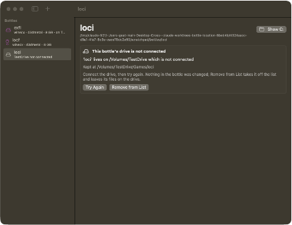
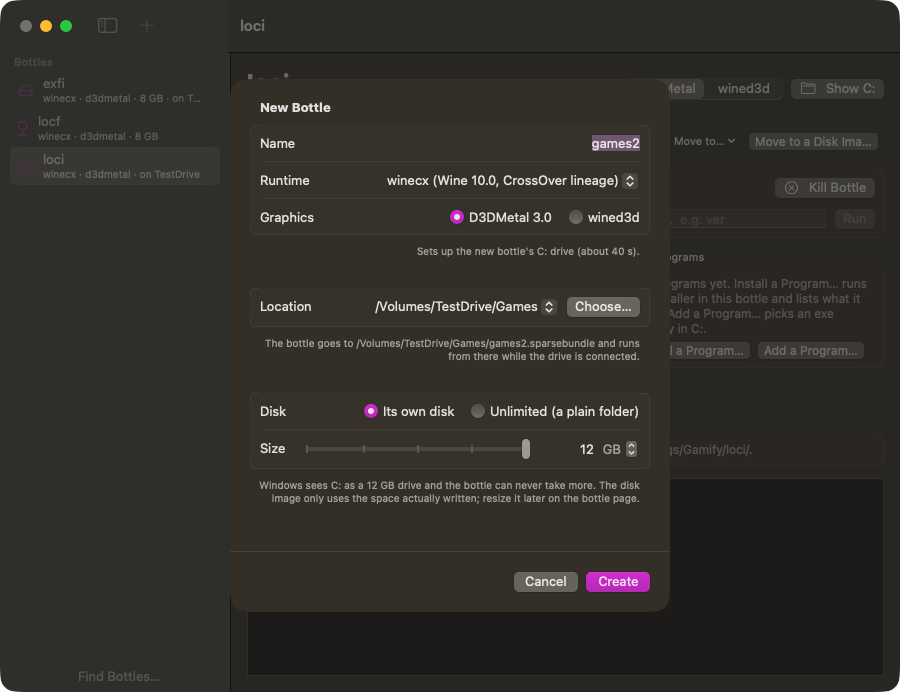
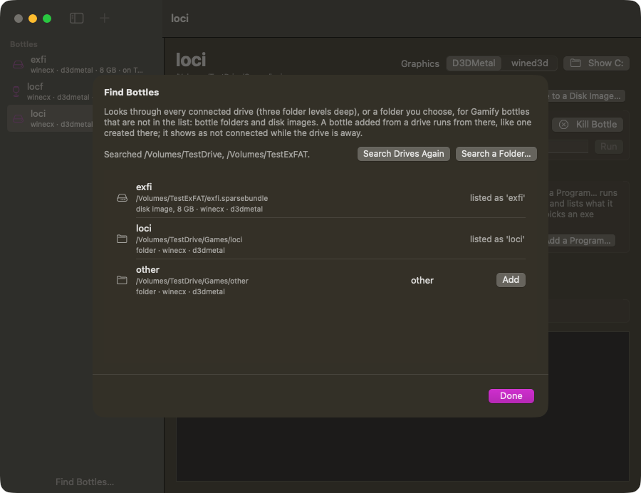
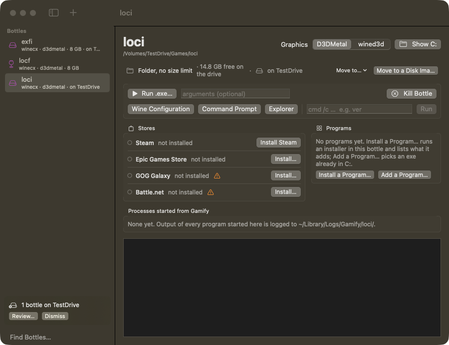

# Cross.app: the macOS GUI (2026-10-16)
> Renamed to **Gamify** on 2026-10-17 (bundle id local.gamify.app, app/build/Gamify.app, data in
> ~/Library/Application Support/Gamify, logs in ~/Library/Logs/Gamify). Paths below that say Cross.app
> or local.cross.app are the old names.

A SwiftUI bottle manager on top of the same code as the `cross` CLI. It does not
have its own launch logic: every action asks `CrossCore` for an `Invocation` (program,
argv, envp, cwd). `cross` `execve()`s it and the app `posix_spawn()`s it.


## Build and run

```sh
app/build.sh            # swift build -c release + wraps it into app/build/Cross.app
open app/build/Cross.app
```

- No Xcode project. `app/` is a Swift Package (swift-tools 5.9, macOS 14, executable
  target `CrossApp`) with a local dependency on `../cli` (product `CrossCore`).
  `build.sh` copies the binary into `build/Cross.app/Contents/MacOS/CrossApp`, adds
  `app/Info.plist` (bundle id `local.cross.app`) and signs it ad-hoc. `swift build` in
  `app/` alone builds the bare executable. Release build takes about 6 s.
- The app finds the checkout like the CLI does: it walks up from its own binary
  (`Project.locate`). Keep the bundle inside the repo, or set the root in
  Settings > Paths (stored in the `crossRoot` user default and passed to
  `Project.locate` as `CROSS_ROOT`, never to Wine).
- **macOS asks "Cross.app would like to access files in your Desktop folder"**,
  because the checkout lives on ~/Desktop. The app's first file access blocks until
  someone answers. The lookup runs off the main thread, so the window shows
  "Opening the Cross checkout…" in the meantime. With a plain ad-hoc signature,
  TCC pins the grant to the cdhash, so **every rebuild asked again**: an unanswered
  prompt left the first test launches with no window for minutes (main thread stuck in
  the TCC call). `build.sh` therefore signs with an explicit designated requirement
  `identifier "local.cross.app"`, so one Allow survives rebuilds (verified 2026-10-17: after one Allow, a debug build, i.e. a different binary, opened without a prompt).
  `CROSS_SIGN_IDENTITY=<identity> app/build.sh` signs with a real certificate instead
  (this machine has none).
- The first launch of a new build can take a few extra seconds anyway (system checks
  of the new binary).

## Structure

```
cli/Package.swift                 products: executable `cross`, library `CrossCore`
cli/Sources/CrossCore/
  Project.swift    root lookup (CROSS_ROOT, walk up from the binary, then the cwd);
                   CROSS_BOTTLES moves the bottles folder (the registry)
  Runtime.swift    winecx + D3DMetal environment (= scripts/winecx-env.sh)
  Bottle.swift     bottles/<name>, cross.json + .runtime fallback, list/load/save
                   (image-backed bottles are mounted here, see "Disk allocation")
  Storage.swift    per-bottle disk images: DiskImage (hdiutil), mount/unmount, resize,
                   move to/from an image, delete, requireIdle (see "Disk allocation")
  Location.swift   bottles kept elsewhere: link + .location file, unreachable-drive
                   messages, file system check, Move to (see "Bottles on other drives")
  Discover.swift   Eject, Find (search drives for bottles), Add, Remove from List
  Steam.swift      webhelper shim, ActiveProcess reset, lock cleanup, installer location,
                   bootstrap check (isBootstrapped, webhelperLog)
  SteamStatus.swift  Steam.status(in:): the bottle's Steam processes (libproc) + the newest
                   state of logs/connection_log.txt, and stuckReason (see "Steam status")
  SteamLibrary.swift  what Steam keeps on disk: KeyValues (.acf/.vdf text), installed apps
                   (appmanifest_*.acf in every library), installedApp(containing:), the
                   account (config/loginusers.vdf), licences (binary appcache/packageinfo.vdf)
  SteamCheck.swift Steam.check (see "Steam check"), the probe launch (steamProbe), runCapturing,
                   programLaunch (Steam games through steam://rungameid)
  Store.swift      Store model (Steam, Epic, GOG Galaxy, Battle.net): installer source and
                   cache, silent install, launcher, workarounds, running check; storeInstaller,
                   storeLaunch, installer (any .exe/.msi); CLI helpers runLogged,
                   bootstrapSteamWaiting (see "Stores and programs")
  Programs.swift   the Programs list: .lnk parser (ShellLink), Start Menu/Desktop scan,
                   programs.json, snapshot + recordInstall after an installer
  Process.swift    execReplacing / runWaiting / Invocation / spawnDetached / Termination
  Updater.swift    self-update: latest.json check, download + SHA-256, staging, detached
                   install helper (docs/updates.md)
  Commands.swift   one function per CLI command, returning an Invocation:
                   loadBottle, createBottle + wineboot, runExe, wineCommand, steam,
                   steamInstaller, steamBootstrap, steamShutdown, waitForBottle, kill,
                   environmentLines
cli/Sources/cross/main.swift      argument parsing + printing only
app/Sources/CrossApp/
  CrossApp.swift   App, AppDelegate (files opened with the app), sidebar (Find Bottles…,
                   found-on-drive banner), New Bottle sheet (Location)
  AppModel.swift   bottles, jobs (processes started from the app), all actions
  BottleView.swift bottle page: Disk row, actions, graphics picker, Stores box (Steam row
                   with its status), process list, log; StorageSheet, StorageSizeField
  AppModel+SteamCheck.swift  checkSteam (Steam.check off the main thread)
  SteamCheckView.swift  the Check… sheet on the Steam row
  AppModel+Location.swift  moveBottle, ejectBottle, mountBottle, forgetBottle, Find/Add,
                   drive mount/unmount notifications
  FindBottlesView.swift  the Find Bottles sheet
  AppModel+Stores.swift  installStore / launchStore, installProgram / addProgram /
                   removeProgram / launchProgram, refreshStoresAndPrograms, InstallPrompt
  ProgramsView.swift  the Programs box (list, Install a Program…, Add a Program… sheet)
  LogView.swift    NSTextView that tails the selected job's log file
  SettingsView.swift  General tab (tutorial), Environment tab (= `cross env`), Paths tab
  TutorialView.swift  first-run tutorial window (six steps, see below)
  Updates.swift    UpdateController (launch check, Check for Updates…), the update banner,
                   Settings > General > Updates (docs/updates.md)
  HelpText.swift   every hover help (`.help`) text, by view (see "Hover help")
```

### CLI refactor check
`cross` behaves byte-for-byte as before the split. A script ran 21 invocations (usage,
`--help`, `bottle list`, `env cx`, `env cx --export`, `WINECX_GRAPHICS=wined3d|bogus`,
`WINEDEBUG`/`MTL_HUD_ENABLED` overrides, a non-winecx bottle, a missing bottle, every
missing-argument and unknown-option error) against the old binary and the new one,
copied to the same path (zsh puts the binary path in `$_`). All 42 stdout/stderr+exit
files were identical, both after the plain split and after main.swift moved onto
`Commands.swift`. `cross cmd cx /c ver` still prints Windows 10.0.19043.

### Process semantics in the app
`spawnDetached(_:output:onExit:)` (CrossCore/Process.swift): `posix_spawn` with
argv[0] = program and exactly the Invocation's envp. The cwd is set with
`posix_spawn_file_actions_addchdir_np` (as `cross run` chdirs before execve). stdin
is /dev/null, and stdout+stderr are appended to a log file. The child gets its own
process group, default signal handlers, an empty signal mask and
`POSIX_SPAWN_CLOEXEC_DEFAULT`. A background thread `waitpid`s and reports
`Termination` (exit code or signal). Output goes to a **file, not a pipe**, so a game or
Steam keeps running and logging after the app quits. This was checked: Steam's
`wine steam.exe` was reparented to launchd and stayed up. `cross bottle create`
(wineboot) and `bottle delete` use the same functions as the CLI.

Logs: `~/Library/Logs/Cross/<bottle>/<yyyyMMdd-HHmmss>-<label>.log`, starting with
`$ cd <cwd>` and `$ <program> <args>` lines written by the app.

The environment is inherited from the app's own process, as `cross` inherits the
shell's. From Finder that is launchd's environment. **`open` from a shell passes that
shell's whole environment** (including any tokens in it) to the app and so to Wine.
For a Finder-like launch from a terminal:
`env -i HOME=$HOME USER=$USER TMPDIR=$TMPDIR PATH=/usr/bin:/bin:/usr/sbin:/sbin open app/build/Cross.app`.

## What works (verified 2026-10-16, macOS 27.0.1, M4 Max)

- Build: `app/build.sh` with no warnings. The app launches, and window ids come from
  `scripts/listwindows.swift`. Screenshots are in docs/screenshots/.
- Sidebar: every directory in bottles/, settings from cross.json with the .runtime
  fallback (exactly `Bottle.list`, as in `cross bottle list`). Non-winecx bottles
  (steam11, steamcx, test) are listed as "bottle.sh only", with actions disabled. The
  list reloads when the app becomes active and on ⌘R.
- **Create bottle** (+ button: name, runtime winecx, graphics D3DMetal/wined3d): created
  `bottles/apptest` with `{"graphics":"wined3d","runtime":"winecx"}` plus `.runtime`.
  wineboot ran as a job with its log while the UI stayed usable. Afterwards
  `cross bottle list` shows it and `cross cmd apptest /c ver` works.
- **Graphics picker** (segmented, in the bottle header) rewrites cross.json
  (apptest switched to d3dmetal, sidebar updated). It applies to programs started
  afterwards.
- **Launch Steam in `cx`**: the same steps as `cross steam` (shim install, ActiveProcess
  reset via regedit, lock cleanup, `steam.exe -noverifyfiles -no-cef-sandbox`, cwd
  = Steam dir) ran off the main thread. The "Sign in to Steam" window appeared after
  about 4 s, then Steam auto-logged in and rendered the store
  ([screenshot](screenshots/steam-cx-from-app.png)). `lsof` confirmed the webhelper
  belonged to bottles/cx.
- **Run .exe**: the open panel starts in the bottle's drive_c and takes optional
  arguments. The same code path runs for an .exe dropped on a bottle page or opened
  with the app (`open -a app/build/Cross.app game.exe`, which runs it in the selected
  bottle; Info.plist declares `com.microsoft.windows-executable` as a Viewer type).
  Verified with `src/d3dtest/d3d11test.exe` in apptest: cwd = its dir, log shows
  "AMD Compatibility Mode", feature level 11_0, 120 frames at 59.7 fps (D3DMetal).
- **cmd**: "Command Prompt" opens Wine's console window (`wineconsole cmd`, because the
  CLI's `cross cmd` needs a terminal). The `cmd /c …` field runs a line with its output
  in the log: `ver` gives Windows 10.0.19043, exit 0.
- **Wine Configuration** (winecfg) and **Explorer** open their windows.
- **Kill Bottle** (`wineserver -k`) closed winecfg and the console in apptest. Per-job
  **Stop** sends SIGTERM to that process only.
- **Settings > Environment**: `Runtime.environmentLines`, the function `cross env`
  prints with, for any winecx bottle, with the `--export` format toggle. The
  "only variables Cross sets" filter (on by default) hides inherited variables. With
  it off, the output is the full `cross env`.
- **Settings > Paths**: root, runtime, D3DMetal, wined3d, shim and logs paths with
  existence checks, plus the root override and (since 0.6) the bottles folder override
  (see "Bottles on other drives").
- Delete bottle (sidebar context menu, with confirmation): `wineserver -k` + remove,
  like `cross bottle delete`.

## Not done / stubbed

- **Install Steam: verified end to end (2026-10-16) in `apptest`, from app buttons
  only.** One click on Install Steam ends at a rendered "Sign in to Steam" window
  ([screenshot](screenshots/steam-apptest-install-from-app.png)), about a minute with the
  cached installer. What was found and changed:
  - `SteamSetup.exe /S` (exit 0, ~3 s) installs only the 7 MB bootstrapper
    (`Steam.exe`, `bin`, `public`, `uninstall.exe`; no `bin/cef`).
  - The normal launch (`steam.exe -noverifyfiles -no-cef-sandbox`) **cannot** bootstrap:
    with -noverifyfiles the bootstrapper logs "Verification skipped", downloads
    nothing and shows a "Steam - Fatal Error" box. So "Launch Steam twice" would not
    have helped.
  - Without -noverifyfiles the first start downloads and installs the win32 then
    win64 client (~1.7 GB), restarting itself twice (the first wine process exits 42),
    then starts Valve's `steamwebhelper.exe`: "Sign in to Steam" appears but is black,
    as expected without the shim. `steam.exe -shutdown` + `wineserver -w` end it in
    about 6 s; the next normal launch installs the shim and renders.
  - The app now chains this. Install Steam: steam-setup job, then (exit 0) the
    **steam-bootstrap** job (`Runtime.steamBootstrap`: ActiveProcess reset, lock
    cleanup, `steam.exe -no-cef-sandbox`). It waits until `bin/cef/cef.win*` has a
    webhelper and `logs/webhelper.txt` ("webhelper launched") was written after the
    launch, plus 5 s, then runs **steam-shutdown** (`steam.exe -shutdown`),
    **wineserver-w** (`wineserver -w`) and the normal **steam** launch (shim, flags).
    Launch Steam on an installed but not bootstrapped bottle runs the same chain.
    While it runs the button reads "Setting up Steam…" and is disabled. Each step has
    its own log; the bootstrap log ends with "cross: client bootstrapped; restarting
    Steam with the webhelper shim". `lsof` confirmed the running webhelper is the shim
    from bottles/apptest.
  - Limits: the wait gives up after 30 min (alert, then Launch Steam retries).
    `wineserver -w` also waits for anything else running in the bottle (winecfg, a
    console). Not logged in, so the first post-login update was not exercised.
  - The CLI is unchanged: `cross steam` on a fresh install still launches with
    -noverifyfiles and hits the Fatal Error (fix by running
    `cross run <bottle> ".../Steam/steam.exe" -no-cef-sandbox` once, then
    `steam.exe -shutdown`). CrossCore only gained new functions; main.swift and the
    existing functions are untouched, so `cross` output is the same.
- I did not click through the open panel itself: it runs in a separate system process.
  Its code path is the same as drag-drop/`open -a`, which was verified.
- Only the winecx runtime is driven, same as the CLI. Bottles on gptk/wine11/sikarugir
  are shown read-only.
- Program list since 2026-10-20 (see "Stores and programs"); still no icons, no
  winetricks/DLL overrides UI, no free-form per-bottle env overrides (WINEDEBUG comes from the
  app's environment, or from Debugging mode since 2026-10-23; sync, HUD, AVX and the D3DM_* variables are Performance settings since
  2026-10-22), no app icon.
- The job list is in memory only; logs stay on disk. A game started by Steam is
  Steam's child, not a job, so use Kill Bottle for it.
- The app bundle must stay inside the checkout, or have its root set in Settings.
  There is no installer or notarization.


## Runtimes (2026-10-17)
The app and the CLI drive every runtime in `Runtime.known` (winecx, winecx-full). The New
Bottle sheet offers the runtimes whose build exists (`Runtime.available(in:)`); a bottle keeps
the runtime in its cross.json and every launch resolves it with `Runtime.loadBottle(_:in:)`.
Settings > Runtimes shows both homes. winecx-full adds the GStreamer plugin variables.

## First-run tutorial (2026-10-17)

A six-step walkthrough in its own window ("Welcome to Cross", SwiftUI `Window` scene
with id `tutorial`, 640×600, not a sheet: the main window stays usable, so the bottle
the tutorial creates shows up in the sidebar while wineboot runs). Back / Next / Skip
Tutorial in the footer, Finish on the last step. Code: `app/Sources/CrossApp/TutorialView.swift`,
hooks in `AppModel` (`shouldOpenTutorialAtLaunch`, `newBottleNameError`,
`suggestedBottleName`, `installRosetta`, `recheckRosetta`; `createBottle` now returns its
wineboot `Job`). Written for someone who got the .app and knows nothing:
no paths of the checkout, no Wine jargon.

| Step | Content | Adapts to |
|---|---|---|
| 1 Welcome | What Cross is (Wine + D3DMetal, through Rosetta), what works (DX9–12, Steam, plain .exe) and what does not (kernel anti-cheat, drivers). | – |
| 2 Rosetta 2 | Why it is needed. | Installed (`Runtime.rosettaAvailable`): green check. Missing: **Install Rosetta 2…** runs `softwareupdate --install-rosetta --agree-to-license` through `NSAppleScript` "with administrator privileges" (the standard macOS password dialog), then `Runtime.recheckRosetta()`; when that returns true the tutorial moves on to the bottle step by itself. Also the command with Copy and **Check Again** buttons for a Terminal install. |
| 3 Bottles | What a bottle is (including its own disk of a chosen size, 64 GB to start). | No drivable bottle: "Create your first bottle" (name field, default `games`/`games2`…, runtime = `Runtime.preferred`, D3DMetal, disk = `Runtime.defaultStorageGB`; the runtime line is hidden when only one runtime is available). Bottles exist: a popup to pick one (with "Steam installed" hints) or "Create a new bottle". **Create Bottle** calls `AppModel.createBottle` and shows the wineboot job's status line and log inline. Rosetta or runtime missing: a warning instead of the form. |
| 4 Steam | What Install Steam does (installer, first start with the 1.7 GB client download and a black window, restart, sign-in window; Cross never sees the password). | Bottle from step 3 with no Steam: **Install Steam** (disabled while its wineboot still runs) = `AppModel.installSteam`, then the step shows the latest job's status and log while `steamSetup` contains the bottle. Steam installed: "already installed" (or "installed, sign in" when started from the tutorial) with a Launch Steam button. No bottle chosen: a hint. |
| 5 Run a game | Launch Steam, Run .exe…, drag-and-drop / open with Cross; graphics picker, winecfg/cmd/Explorer, Kill Bottle. | – |
| 6 Where things live | Bottles (`Project.bottles`), Logs (`~/Library/Logs/Cross`), Downloads (`Project.downloads`), each with a Show-in-Finder button; Settings (SettingsLink). Finish. | Paths come from the located project, so a bundled app shows Application Support, not a checkout. |

When it shows:
- First launch: `AppModel.shouldOpenTutorialAtLaunch()` returns true when the user default
  `tutorialShown` (domain `local.cross.app`) is not set, and sets it right away (closing the
  window counts as seen). `ContentView` opens the window once `isLocating` is false, i.e.
  after the Desktop-folder permission prompt, so the bottle step has a project.
- Replay: **Help > Cross Tutorial** (`TutorialCommands`) or **Settings > General > Show
  Tutorial Again**. "Show on Next Launch" there clears the flag.
- Reset for testing: `defaults delete local.cross.app tutorialShown`, or launch with
  `CROSS_RESET_TUTORIAL=1` in the environment (AppModel.init removes the key), e.g.
  `env -i HOME=$HOME USER=$USER TMPDIR=$TMPDIR PATH=/usr/bin:/bin:/usr/sbin:/sbin CROSS_RESET_TUTORIAL=1 open app/build/Cross.app`.

Verified 2026-10-17 (release build, `CROSS_RESET_TUTORIAL=1`, driven with System Events
clicks on the footer buttons): every step rendered
([1](screenshots/tutorial-1-welcome.png), [2](screenshots/tutorial-2-rosetta.png),
[3 pick](screenshots/tutorial-3-bottles-pick.png), [3 create](screenshots/tutorial-3-bottles-create.png),
[3 creating](screenshots/tutorial-3-bottles-creating.png), [3 created](screenshots/tutorial-3-bottles-created.png),
[4 install](screenshots/tutorial-4-steam-install.png), [4 progress](screenshots/tutorial-4-steam-progress.png),
[4 done](screenshots/tutorial-4-steam-done.png), [5](screenshots/tutorial-5-run.png),
[6](screenshots/tutorial-6-locations.png)). Create Bottle made `bottles/games`
(`{"graphics":"d3dmetal","runtime":"winecx"}`), wineboot exit 0 in about 15 s with its log in
the tutorial, the bottle selected in the main window and listed by `cross bottle list`.
Install Steam from the tutorial ran the steam-setup → steam-bootstrap → steam-shutdown →
wineserver-w → steam chain in `games` with the bootstrap log tailing inside the step, and
ended about 50 s later (cached installer) at a rendered "Sign in to Steam" window
([screenshot](screenshots/tutorial-4-steam-signin.png)); the step then read "Steam is
installed in 'games' and should be showing its Sign in window". The Rosetta-missing branch could not be
exercised on this machine (Rosetta is installed); its install path is the documented
`NSAppleScript` call followed by `Runtime.recheckRosetta()`. The New Bottle sheet also
defaults to `Runtime.preferred` and hides the Runtime picker when only one runtime is present.

Settings > Paths was reorganised for the packaged app
([screenshot](screenshots/settings-paths.png)): "Your data" (`Project.bottles`,
`Project.downloads`, logs), "Runtime" (only the available runtimes, D3DMetal, wined3d, the
shim, `Project.notices`, Rosetta 2 state) and "App" (bundled: just the runtime files
location) or "Checkout" (root plus the root override, shown only when not bundled).


## Steam status, stuck detection and Restart Steam (2026-10-17)

Background: a Steam that lost its connection (Mac asleep, network change) does not
recover by itself, and `steam.exe` is single-instance per prefix, so Launch Steam only
forwarded to the stale client: the user saw "NO CONNECTION" while the Mac, the account
and Wine's networking were fine. A `steamwebhelper_real.exe` can also outlive a crashed
or killed `steam.exe`. `cross kill cx` + a normal launch fixed it. The app now does that
itself, without the user knowing what wineserver is.

### CrossCore: `Steam.status(in:)` (`cli/Sources/CrossCore/SteamStatus.swift`)
- **Processes** (`Steam.processes(in:)`): every process whose working directory is inside
  the bottle's prefix, found with libproc (`proc_listallpids`,
  `proc_pidinfo(PROC_PIDVNODEPATHINFO)` for the cwd, `PROC_PIDTBSDINFO` for the start
  time) and `sysctl KERN_PROCARGS2` for the Windows command line. The environment of a
  Rosetta process is not readable from another process (`ps -E` shows nothing for them),
  but Wine keeps the unix cwd inside the prefix: `steam.exe` runs in its Steam dir and
  the webhelpers inherit it, `C:\windows\...` services run in drive_c/windows.
  `steam.exe -shutdown` requests are not counted as Steam. About 10 ms for 1000 pids.
  `Processes.hasOrphanWebhelper`: webhelper processes but no `steam.exe`.
- **Connection** (`Steam.connection(in:)`): the newest line of
  `Program Files (x86)/Steam/logs/connection_log.txt` that carries a state, i.e.
  `[2026-10-17 13:23:40] [Logged On, 4, 7] [U:1:…] …`. Only the last 128 KB are read;
  Steam rotates the file on start, so the newest session is always in it. States seen in
  cx: Connecting, Connected, Logging On, Logged On, Logging Off, Logged Off.
  `ConnectionState`: `.loggedOn`, `.connecting` (Connecting/Connected/Logging On) and
  `.loggedOff(name)` for everything else ("Logged Off", "No Connection", …), plus the
  reason when the log gives one ("Session Replaced", "Disconnected By Remote Host").
  The file has CRLF line endings; Swift treats `\r\n` as one Character, so the parser
  splits on `isNewline`, not on `"\n"` (that bug returned nil on the first try).
- **`Status.stuckReason`** (plain English, shown to the user):
  - an orphaned webhelper: "Steam's window process is still running, but Steam itself has quit.";
  - `steam.exe` older than 90 s (`Status.startupGrace`) and the newest state is
    `.loggedOff` with a timestamp after the process start: "Steam lost its connection at
    15:48 (Session Replaced).";
  - `.connecting` for more than 90 s: "Steam has been trying to connect since …".
  A fresh start is never stuck: the previous session's "Logged Off" line is older than
  the process, and the 90 s grace covers the connect. The 2026-10-17 incident would have
  matched the second rule: the newest state line was "Logged Off … Session Replaced" from
  the previous day, written after that steam.exe started, and the hourly
  `CClientJobGetClientUpdateHosts: failed to get updated list, error 3` lines that
  followed carry no state.

### App
- **Restart Steam** (`AppModel.restartSteam`), the button next to Launch Steam, with a job
  per step so the list shows the progress: `steam-shutdown` (`steam.exe -shutdown`),
  `wineserver-w` (up to 20 s, then the job is stopped), `wineserver-k` (to be sure: a
  stuck client or an orphan does not react to -shutdown), a second `wineserver-w` (up to
  10 s, so the new Steam does not race the dying server), then the normal `steam` launch
  (shim, ActiveProcess reset, lock cleanup). While it runs the button reads "Restarting
  Steam…" and the status line "Steam: restarting…" (`steamRestarting`).
- **Launch Steam checks first** (`AppModel.launchSteam`): when the client is bootstrapped
  it reads `Steam.status` off the main thread; if `stuckReason` is set the bottle page shows
  the alert "Steam looks stuck" with the reason and "Restart it? Steam quits and starts again;
  nothing is lost." (Restart Steam / Cancel, `steamStuckPrompt`). Otherwise the launch runs
  as before (a healthy running Steam just gets its window raised by the forwarding).
- **Status line** under the actions on the bottle page (only when Steam is installed):
  "Steam: installed, not running" / "running, starting…" (no state line yet for this
  process) / "running, connecting…" / "running, online" / "running, offline since 15:48" /
  "not running properly" (orphan), with a dot (grey, orange, green, red) and, when
  `stuckReason` is set, the reason and a small Restart Steam button. `BottleView` refreshes
  `model.steamStatus[bottle]` every 3 s in a `.task(id:)` loop while the page is shown.
- **Tutorial**, Steam step: one sentence pointing at Restart Steam for a Steam that shows
  "No connection" or stops responding.
- The CLI is unchanged (CrossCore only gained `SteamStatus.swift`).

### Verification status (2026-10-17, bottle `steamtest`)
`bottles/cx` (and every other bottle) disappeared from `bottles/` at 13:36:45 while this was
being built: the user had deleted them to free disk space (confirmed afterwards). With
the parent session's OK a new bottle **`steamtest`** (winecx, D3DMetal) was created with the
CLI and Steam installed from the app's Install Steam button (setup → bootstrap → shutdown →
wineserver -w → steam, about a minute, ending at "Sign in to Steam"). Everything below was
first verified signed out; the signed-in case was verified afterwards, see the last bullet.

Verified in the app (release build, driven with System Events clicks and screenshots):
- **Signed-in re-logon (verified 2026-10-17 14:47)**: with the user signed in to Steam in
  `steamtest` (logon 'OK' at 14:20), steam.exe was killed with
  `pkill -f 'steam.exe -noverifyfiles'` (the status line went to "installed, not running"),
  then Restart Steam was clicked in the app: jobs steam-shutdown, wineserver-w, wineserver-k,
  wineserver-w, steam ran in order, and connection_log.txt showed a fresh
  `LogOn() called` → `ConnectionCompleted` → `RecvMsgClientLogOnResponse() : 'OK'` three
  seconds after the new steam.exe started; the status line read "Steam: running, online"
  (green). Steam's saved refresh token survives the restart, so no sign-in is needed.
- **Status line**: "Steam: installed, not running", then after Launch Steam
  "Steam: running, connecting…" with the orange dot
  ([screenshot](screenshots/steam-status-running.png)); on the current build the signed-out
  states read "running, not signed in" (connection lines carry `[U:1:0]`).
- **Orphaned webhelper**: `pkill` of steam.exe takes the webhelper down with it at the
  sign-in window (SIGTERM and SIGKILL alike), unlike the incident on the signed-in cx. The
  orphan was reproduced by starting `steamwebhelper_real.exe --disable-gpu --single-process`
  alone in the bottle (`cross run`): `Steam.status` reported `orphan: true`, the status line
  turned red, "Steam: not running properly", with the reason and a Restart Steam button
  ([screenshot](screenshots/steam-status-stuck.png)).
- **Launch Steam on the stuck bottle** showed the alert "Steam looks stuck" with the reason
  and Restart Steam / Cancel ([screenshot](screenshots/steam-stuck-alert.png)); it waits for
  the click (checked for 24 s with no input: no job started). Restart Steam is the default
  button (Return accepts it).
- **Restart Steam** from the alert: no steam.exe, so the `-shutdown` step is skipped;
  `wineserver-w` ran into its 20 s limit (the orphan ignores -w) and was stopped (shows as
  "signal 15"), `wineserver-k` exit 0, the second `wineserver-w` exit 0 at once, then the
  `steam` job; the button read "Restarting Steam…" and the status line "Steam: restarting…"
  ([screenshot](screenshots/steam-restarting.png)). The "Sign in to Steam" window was back
  28 s after the click, `Steam.status` found steam.exe plus two webhelpers, the status line
  read "running, connecting…" ([screenshot](screenshots/steam-restarted.png)).
- **Log parser** on the real cx excerpts (CRLF): "Session Replaced" → loggedOff with that
  reason and the account; "user initiated logoff" → loggedOff, `isSignedOut`; `[U:1:0]` →
  no account. On the live cx before it vanished: steam.exe + 2 webhelpers found, "Logged On
  at 13:23:40", not stuck, 8 ms.

Found on the way:
- **`steam.exe -shutdown` with no client running starts the bootstrapper**, which verifies
  the whole install (no -noverifyfiles) for 3-4 minutes. `restartSteam` therefore runs the
  shutdown step only when a steam.exe is running, and stops it after 15 s.
- **After an unclean end Steam's next start often quits by itself** after 2-3 s: the job log
  shows "Looks like steam didn't shutdown cleanly, scheduling immediate update check",
  "Nothing to do", "Verification skipped", "Shutdown"; the start after that works. Seen on
  three of four starts after a kill or wineserver -k today. `startSteamAgainIfItQuits`
  (used by Launch Steam and by the restart's final step) watches the `steam` job for 15 s
  and starts it once more when it ended with no steam.exe left (log line "cross: Steam quit
  right after starting …"). While it watches, the button stays "Restarting Steam…".
- The `.alert` is not reachable through System Events (no sheet, no window); it was
  accepted with a Return keystroke. `click at {x,y}` needs assistive access for osascript.
- The user was clicking in the app during the first run (Restart Steam twice, Kill Bottle
  twice, windows moved between displays), which produced overlapping job chains in the
  logs of 13:45-13:49; nothing in them is a bug of the chain itself.

## Disk allocation (2026-10-19)

A bottle can get its own disk of a chosen size, like a VM's virtual disk, instead of a
folder that grows without limit. New bottles get one by default (64 GB, or the free
space when the disk has less); existing bottles stay plain folders and load unchanged.

### Design

An image-backed bottle `foo` is an APFS sparse bundle next to its mount point:

```
bottles/foo.sparsebundle      hdiutil create -type SPARSEBUNDLE -fs APFS -size 64g -volname foo
                              + hdiutil resize -size 64g (a fresh image's volume is ~200 MB
                                short of -size; after the resize it is exactly 64 GiB)
bottles/foo/                  hdiutil attach -nobrowse -noautoopen -mountpoint bottles/foo
                              (not in Finder's sidebar, no window). While unmounted it holds
                              only .gamify-disk-image (the image's file name), written by
                              every mount, so a missing image is reported, not shown as an
                              empty folder bottle
bottles/foo/cross.json        inside the volume, as before, plus
                              "storage": {"image": "foo.sparsebundle", "sizeGB": 64}
bottles/foo/.metadata_never_index   keeps Spotlight off the volume (it would hold it busy)
```

- A bottle is image-backed exactly when `bottles/<name>.sparsebundle` exists; nothing else
  needs to be stored to find it (no sidecar file inside the bundle). The volume's own
  size (statfs) is the live value shown everywhere; `storage.sizeGB` records what was set.
- Sparse: the image takes only what was written (a fresh bottle: 1.7 GB). Deleting files
  inside the bottle does not shrink it by itself; `hdiutil compact` (run by every resize,
  also "resize" to the same size) gives the space back (0.2 s, reclaimed 8.2 GB in a test).
- Windows sees C: (drive_c on the volume) as a drive of the allocated size:
  `GetDiskFreeSpaceExW("C:\\")` = 10.00 GB for a 10 GB bottle, and a write past the end
  fails with ERROR_DISK_FULL (112). Wine's `fsutil` has no `volume diskfree` and WMI's
  `Win32_LogicalDisk.Size` is a constant (82252800000 for every drive); `dir C:\` shows
  the real free bytes.
- Units: whole GiB, called GB as hdiutil (`64g`) and Windows do. Minimum 8 GB, maximum
  what the bottle already uses plus the free space of the disk the image is on
  (`volumeAvailableCapacityForImportantUsage`, which counts purgeable space as Finder does:
  358 GB here while `df` said 51 GB).
- Mounting is lazy: `Bottle.load` and `Bottle.list` attach an image whose mount point is
  not a mount point (statfs `f_mntonname` == realpath of the prefix), so the CLI and the app
  work after a reboot or an `hdiutil detach`. `Bottle.list` shows image bottles even when
  they cannot be mounted (`Bottle.storageError`); the app shows an error page with Try
  Again, `cross bottle list` an "unavailable: …" column.
- Failure modes handled: image missing (marker left, error names the image); attach fails
  (error from hdiutil); image already mounted elsewhere (found with `hdiutil info -plist`,
  ejected and mounted at the bottle; if that eject fails because something uses it, the
  error says where it is mounted); files in the unmounted mount point (refused, they would
  be hidden under the volume).

### Operations (CrossCore `Storage.swift`, used by the CLI and the app)

| Operation | Steps |
|---|---|
| create (`createBottle(name:config:storageGB:)`) | range check, image create + resize, marker, attach, cross.json, then wineboot as before |
| resize (`resizeStorage`) | `requireIdle`, check the range (shrink only to at least the used space, rounded, plus 1 GB), detach, `hdiutil resize -limits` minimum when shrinking, `hdiutil resize -size Ng`, `hdiutil compact`, attach (also after a failed resize), update `storage.sizeGB` |
| folder -> image (`moveToImage`) | `requireIdle`, measure the folder, need its size + 1 GB free, create the image and attach it at `bottles/.<name>.moving`, `ditto` (keeps dosdevices symlinks, modes, xattrs), compare both trees (every relative path with kind, file size and symlink target), detach, rename the folder to `bottles/.<name>.folder`, mount the image at the bottle, write `storage`, remove the backup. A failure before the swap removes the image and leaves the folder untouched; after it, the folder is put back |
| image -> folder (`moveToFolder`) | `requireIdle`, `ditto` the volume into `bottles/.<name>.moving`, compare, eject, move the image aside, swap the folder in, drop `storage`, delete the image |
| delete (`deleteBottle`) | `wineserver -k` (+ `-w` for images), eject (forced if need be), remove the image and the mount point |

`requireIdle` refuses while Windows programs run in the bottle: processes whose cwd is in
the prefix (`Steam.bottleProcesses`) and, for programs started from elsewhere (a `cross
cmd` from a shell keeps the shell's cwd), the bottle's wineserver answering on
`/tmp/.wine-<uid>/server-<dev>-<inode>/socket` (connect succeeds only while it runs). A
server that only lingers after its last program is waited for up to 10 s (it writes the
registry files when it exits, so the volume must not be ejected under it).

hdiutil notes (macOS 27.0.1): every `hdiutil create/attach/detach/resize` prints a warning
that it is deprecated in favour of `diskutil image …`, and still works; CrossCore filters
the warning out of error messages. `hdiutil resize` on an attached image fails with
"Resource temporarily unavailable (35)", by path and by /dev/disk, hence detach first; it
takes ~0.4 s and the APFS container and volume follow (grow and shrink). Attaching an image
that is attached at another mount point fails with "Resource busy"; at the same mount point
it is a no-op. All of it runs as the normal user (no sudo).

### CLI

```
cross bottle create <name> [--storage <GB>|unlimited]   (default 64 GB, capped by free space)
cross bottle set <name> storage <GB>      resize an image bottle, or move a folder bottle into a new image
cross bottle set <name> storage unlimited move an image bottle back into a folder
cross bottle set <name> --storage <GB>    same
cross bottle list                         last column: folder (no limit) | image 1.7 GB used of 10.0 GB | unavailable: …
cross bottle delete <name>                also ejects and removes the image
```

### App

- **New Bottle sheet**: a Disk section with "Its own disk" (default) / "Unlimited (a plain
  folder)" and a Size row (slider over the allowed range, whole-GB field, stepper). Create
  is disabled outside the range. With less than 8 GB free only the folder is offered.
- **Bottle page**: a Disk row under the header. Image bottles: a bar with used / allocated
  and free ("1.7 GB of 10.0 GB used, 8.3 GB free"; orange above 75 %, red above 90 %),
  refreshed with the Steam status every 3 s (`AppModel.refreshStorage`), and **Change…**.
  Folder bottles: "Folder, no size limit · N GB free on this Mac" and **Move to a Disk
  Image…**. While an operation runs the row shows its step ("Creating a 9 GB disk image…",
  "Copying 3.2 GB of 11 GB…", "Verifying the copy…"), the sidebar shows the spinner, the
  action buttons are disabled and `AppModel.start` refuses launches in that bottle.
- **StorageSheet** (Change… / Move to a Disk Image…): the current use, the Size row, Resize
  or Move, and for image bottles **Move to a Folder (no size limit)**.
  `AppModel.setStorage` refuses with an alert while jobs, Windows processes or the
  bottle's wineserver run ("Quit them (or use Kill Bottle)"), then runs the CrossCore
  operation off the main thread.
- Sidebar subtitle: `winecx · d3dmetal · 10 GB` for image bottles, "disk image
  unavailable" when it cannot be mounted. Delete Bottle goes through `Runtime.deleteBottle`.

### Verified (2026-10-19, CROSS_BOTTLES in a scratch dir, runtimes from the checkout)

| Check | Result |
|---|---|
| `cross bottle create st10 --storage 10` | image + wineboot in 18 s; `bottle list`: image 1.7 GB used of 10.0 GB; bundle 1.7 GB on disk |
| Windows' view | `GetDiskFreeSpaceExW`: C: total 10.00 GB (10737418240 bytes), free 8.27 GB; `dir C:\`: 8,884,961,280 bytes free |
| write past the end | a test exe writing 9 GB to C:\big.bin: "WriteFile failed after 8.23 GB: error 112 (ERROR_DISK_FULL)"; the bottle kept working |
| grow | `cross bottle set st10 --storage 20`: 1.2 s, Windows C: total 20.00 GB |
| shrink | to 5: "below the minimum of 8 GB"; with 7.7 GB used, to 8: "below the minimum of 9 GB"; to 12: done, C: 12.00 GB; same size again: compacted 7.8 -> 1.7 GB on disk |
| busy | resize while `cross cmd st10 /c ping -n 25 …` ran (cwd outside the prefix): refused after 10 s ("its wineserver is still up"); afterwards it worked |
| reboot simulation | `hdiutil detach bottles/st10`, then `cross cmd st10 /c ver`: remounted, Windows 10.0.19043 |
| mounted elsewhere | `hdiutil attach -mountpoint elsewhere`: list ejected it and remounted at the bottle; with a shell cd'd into it: listed "unavailable: … already mounted at … cannot be ejected (… Resource busy)"; next list after the shell left: fine |
| stray files / missing image | a file in the unmounted mount point: refused with its name; image moved away: "the disk image of 'st10' (st10.sparsebundle) is missing"; moved back: fine |
| folder -> image -> folder | 1.7 GB folder bottle `fb` to a 9 GB image (7.6 s), C: 9.00 GB, exes ran; back to a folder (5 s), runs, cross.json without `storage`, nothing attached. A 5.7 GB folder bottle (4 GB payload) to a 12 GB image: 8.6 s, payload intact, C: 12.00 GB |
| delete | image bottle, image bottle mounted elsewhere, folder bottle: nothing left in bottles/, `hdiutil info` and `mount` show nothing |
| existing bottles | checkout `steamtest` (folder, 21 GB) and the 0.3 app's `Steam` bottle list as "folder (no limit)"; `cross cmd steamtest /c ver` runs; steamtest's cross.json byte-identical |
| app | `app/build.sh` builds; New Bottle sheet, bottle page (image and folder), StorageSheet, a move and a resize driven through `AppModel.setStorage`, the unavailable-image page and Delete Bottle checked with window screenshots (a test copy with its own bundle id, sheets opened by a temporary launch hook that is not committed) |

Not verified: converting a bottle above ~6 GB (the cx-sized 11 GB case). The Mac had
25 GB free during the test while the user's Steam download was filling the disk, so the
21 GB `steamtest` copy was not attempted; at the measured ~0.7 GB/s an 11 GB bottle
takes ~17 s plus the comparison. The tree comparison checks paths, kinds, sizes and
symlink targets, not file contents (ditto is trusted for the bytes). Clicking through
the sheets by hand was not done (no UI automation access); their actions were exercised
through the same AppModel calls.


## Bottles on other drives (2026-10-20)



A bottle can live outside the bottles folder, e.g. on an external drive, and run from
there. The bottles folder stays the registry of bottles: a bottle kept elsewhere is
reached through a symlink in it, so every existing code path (Bottle.list/load, process
detection by cwd, Programs, Stores, Storage, WINEPREFIX) works unchanged.

### Layout

```
folder bottle `foo` kept in /Volumes/Ext/Games:
  bottles/foo                 -> /Volumes/Ext/Games/foo              (symlink)
  bottles/foo.location           "/Volumes/Ext/Games/foo"           (the target's real path)
image-backed bottle `bar` kept in /Volumes/Ext/Games:
  bottles/bar.sparsebundle    -> /Volumes/Ext/Games/bar.sparsebundle (symlink)
  bottles/bar                    the mount point, local like every image bottle's
  bottles/bar.location           "/Volumes/Ext/Games/bar.sparsebundle"
  bottles/.bar.ejected           only after Eject (see below)
```

- cross.json stays inside the bottle. `Bottle.location` is the target (nil for a bottle in
  the bottles folder); `Bottle.home(in:)` the folder that holds it.
- `Bottle.list` follows links (`URL.isDirectoryKey` is false for a symlink, so entries are
  checked with `fileExists(isDirectory:)`) and also lists names that only have a
  `.location` file or a dangling link. Paths are compared as real paths (realpath(3)):
  `Steam.bottleProcesses` already matched the cwd against the prefix's real path.
- **Drive not connected**: the `.location` file names the target even when the link
  dangles, so the bottle is listed with `storageError` "'foo' lives on /Volumes/Ext which
  is not connected" (a target under /Volumes whose volume is not a mount point), or "is
  missing from <folder>" when the drive is there but the bottle is not. The app shows the
  page above (Try Again, Remove from List) and the sidebar says "Ext not connected".
  Nothing is deleted or recreated automatically. The app reads the list again when a drive
  is mounted or unmounted (NSWorkspace notifications), so a bottle comes back by itself.
- **File systems**: a folder bottle needs APFS or Mac OS Extended (statfs `f_fstypename`
  apfs/hfs). A Wine prefix holds symlinks (dosdevices/c: -> ../drive_c, z: -> /) and relies
  on Unix permissions, which exFAT, FAT and NTFS do not have; network shares are refused
  for folders too. A disk image works on any writable file system (a sparse bundle is a
  folder of 8 MB band files with APFS inside): verified on exFAT. On exFAT macOS keeps
  extended attributes in `._*` files next to every file (FileManager does not list them);
  a move off exFAT deletes the ones ditto copied. A fresh image on exFAT reported 3.5 GB
  used inside (1.7 GB on APFS) while taking 1.7 GB on the drive.
- **Eject**: an image bottle on another drive stays mounted once used, and macOS then
  refuses to eject that drive ("dissented by diskimages-helper"). Eject (bottle page >
  Move to… > Eject, sidebar menu, `cross bottle eject`) unmounts the image and writes
  `bottles/.<name>.ejected`, so listing the bottles (the app does it every time it comes to
  the front) does not mount it again; the bottle shows "ejected" with a Mount button, and
  using it (`Bottle.load`: cross cmd, launching anything) mounts it and removes the flag.
  A folder bottle needs no eject: once its programs are closed the drive ejects normally.
- **Ownership**: Wine refuses a prefix owned by another uid ("not owned by you"). A drive
  from another Mac keeps that Mac's uid unless the volume ignores ownership (the default
  for most external drives); Add checks this for folder bottles and says what to do
  (Get Info > "Ignore ownership on this volume"). Image bottles are mounted by hdiutil with
  `noowners`, so they are not affected.

### Operations (CrossCore `Location.swift`, `Discover.swift`)

| Operation | Steps |
|---|---|
| create (`createBottle(…, location:)`) | `checkLocation` (exists, real path, not inside the bottles folder or a bottle, writable; the bottles folder itself = default), folder bottles: file system check, `<folder>/<name>`, link + `.location`, cross.json; image bottles: `hdiutil create` at `<folder>/<name>.sparsebundle`, link, `.location`, mount at bottles/<name>. Sizes: `storageRange`/`defaultStorageGB` take `home:` = the chosen folder, so the limit is that drive's free space |
| move (`moveBottle(_:to:)`) | `requireIdle`; folder: `ditto` into `<target>/.<name>.moving`, compare trees, rename to `<target>/<name>`, then swap the entry (a real folder is renamed to `bottles/.<name>.folder` first; a link is replaced with one rename(2); back to the default folder the link is removed and the copy takes its place), `.location` updated or removed, original deleted. Image: eject, `ditto --norsrc --noextattr --noacl --noqtn` the whole .sparsebundle, compare, swap the same way, mount from the new place, delete the old image. Failures undo the steps done so far and remount the original |
| folder <-> image while elsewhere | `moveToImage` creates the image next to the folder (same drive) and links it; `moveToFolder` puts the folder next to the image and refuses on exFAT |
| delete | data at the target, link, `.location`, mount point; a bottle whose drive is not connected loses only its entries (its data cannot be reached, so it is left alone; the CLI and the app say so) |
| eject / mount | see above |
| find (`Bottle.find`) | the connected local, writable volumes under /Volumes except the startup disk (`searchableVolumes`; network shares only when chosen as a folder), or chosen folders, 3 levels deep, not into packages or hidden folders: folders with drive_c + system.reg/cross.json, and .sparsebundle images, attached read-only at a temporary mount point for a moment to read their cross.json (images without one are not bottles and are skipped). Each result says whether it is already listed (real paths of the bottles folder's entries) |
| add (`addBottle(at:name:)`) | link + `.location` under the folder's name or another one; an image's `storage.image` is renamed when added under another name; refused when it is already listed, the name is taken, the folder is not a prefix, the file system cannot hold folders, or the owner check fails |
| remove from list (`forgetBottle`) | unmount (image), remove link(s), `.location`, mount point and flag; the data stays |

### Bottles folder (Settings > Paths)

`Project.bottlesOverride` (from `CROSS_BOTTLES`; the app sets it from the `bottlesFolder`
user default, Settings > Paths > Bottles folder, Choose… / Reset to Default) replaces
`<dataDir>/bottles` as the registry: new bottles go there and the list is read from there.
Since 0.6 `CROSS_BOTTLES` moves only the bottles; downloads stay in the data dir (before,
its parent became the data dir). Bottles in the old folder are not listed while another
folder is set; the help text says to reset the setting or move them first. To keep one
bottle elsewhere, use its location instead (it stays in the list).

### CLI

```
cross bottle create <name> [--storage <GB>|unlimited] [--location <folder>|default]
cross bottle set <name> location <folder>|default   move (verified copy, then swap)
cross bottle list            "  (in /Volumes/Ext/Games)" after bottles kept elsewhere;
                             "unavailable: 'foo' lives on /Volumes/Ext which is not connected"
cross bottle eject <name>    unmount an image bottle until it is used again
cross bottle find [<folder>...]   default: every connected local drive
cross bottle add <folder|image> [--name <name>]
cross bottle forget <name>   take a bottle kept elsewhere off the list, keep its files
cross bottle delete <name>   removes the data at the target too (only the entries when unreachable)
```

### App



- **New Bottle**: a Location section: "Bottles folder" or a folder picked with Choose…
  (NSOpenPanel, can create folders; the footer names the exact target). The Disk size
  range and default follow the chosen drive's free space. On a drive that cannot hold a
  folder bottle, "Unlimited (a plain folder)" shows why and Create is disabled; choosing
  such a drive switches to "Its own disk".
- **Bottle page**: the header shows where the bottle really is; the Disk row says "on
  Ext" (or "in the bottles folder") with a **Move to…** menu: Choose a Folder… (refused
  with an explanation for a folder bottle and an exFAT target), The Bottles Folder, and
  Eject for an image bottle kept elsewhere. Progress shows in the row like a disk move.
  Unavailable bottles get a page per cause: drive not connected (Try Again, Remove from
  List), ejected (Mount), image cannot be opened (Try Again).
- **Sidebar**: an external-drive icon and "on Ext" for bottles kept elsewhere ("Ext not
  connected", "ejected"); context menu Eject and Remove from List…; Delete Bottle says
  what it will remove. **Find Bottles…** at the bottom of the sidebar (also in the File
  menu) opens the sheet below; when a drive is connected while the app runs it is searched
  and a banner offers the bottles that are not listed yet (Review… / Dismiss).




### Verified (2026-10-20, CROSS_BOTTLES in a scratch dir, runtimes from the checkout)

The "external drive" was a 20 GB APFS sparse bundle attached at /Volumes/TestDrive
(`hdiutil attach -mountpoint /Volumes/TestDrive` works without sudo), unplugging was
`hdiutil detach`; the exFAT drive an 8 GB `hdiutil create -fs ExFAT` image at
/Volumes/TestExFAT. Test bottles 8 GB images / ~1.7 GB folders.

| Check | Result |
|---|---|
| create on the drive | `bottle create extf --storage unlimited --location /Volumes/TestDrive/Games` (17 s) and `exti --storage 8` (16 s); links + `.location` in bottles/, data on the drive; `cross cmd <b> /c ver`: Microsoft Windows 10.0.19043 in both |
| list | `folder (no limit)  (in /Volumes/TestDrive/Games)`, `image 1.7 GB used of 8.0 GB  (in …)` |
| process detection through the link | notepad.exe copied as Epic's EpicGamesLauncher.exe and as Steam's steam.exe: `cross store launch <b> epic` -> `cross store list <b>`: epic running (both bottles), steam running then installed after kill; `set location` while it ran: refused ("cannot move the bottle while programs run in 'extf' (epicgameslauncher.exe, …)") |
| unplug | plain `hdiutil detach /Volumes/TestDrive` with exti mounted: refused, "dissented by … diskimages-helper" (what Finder would hit, hence Eject); after unmounting it: ejected; list: both "unavailable: 'extf' lives on /Volumes/TestDrive which is not connected"; `cross cmd` refuses with the same text; app page screenshot above |
| plug back | list fine, `cross cmd` works in both; in the running app the page switched back by itself (mount notification) |
| eject | `cross bottle eject exti`: unmounted, list "ejected …", drive then ejects cleanly; after re-attaching it stays ejected until `cross cmd exti` mounts it |
| another Mac (second bottles folder) | `cross bottle find`: both found "not listed" (0.7 s, image looked into read-only); `bottle add …/extf --name extf2` and `add …/exti.sparsebundle`; adding extf again: "already listed as 'extf2'"; both run; `forget` both: entries gone, data and the first registry untouched |
| move, folder | default -> drive (1.7 GB, 4.4 s), drive -> another folder on it, drive -> default; runs after each |
| move, image | default -> drive (2.9 s), drive -> another folder, drive -> default; runs after each |
| convert while elsewhere | located folder -> 8 GB image next to it, located image -> folder next to it; both run |
| delete | located folder and (ejected) located image: data, links, `.location` gone, `hdiutil info` shows nothing left; with the drive unplugged: only the entries removed ("its data … could not be reached and was not touched"), Find saw both again afterwards |
| exFAT | folder bottle: refused on create, on move and on image -> folder ("/Volumes/TestExFAT is formatted as exFAT, which cannot hold a folder bottle …"); image bottle: created and boots (`/c ver`), moved onto exFAT and off again (no `._` files left on APFS) |
| size limit follows the drive | exFAT drive with 6.4 GB free: `--storage 9 --location /Volumes/TestExFAT` refused ("at most 8 GB"), the same in the default folder (12 GB free) accepted |
| bottles folder override | `bottlesFolder` user default set to a second folder: the app listed only that folder's bottle; key deleted afterwards |
| app | `app/build.sh`; screenshots of the New Bottle Location choice, the not-connected page, the drive banner and Find Bottles (launched with an uncommitted hook that opens the sheets; the app was started with CROSS_ROOT/CROSS_BOTTLES in its environment) |

Not verified: a real USB/Thunderbolt drive and pulling it out while an image bottle is
mounted (simulated only with `hdiutil detach`; a forced detach of a volume holding a
mounted image was not tried); a drive from a real second Mac with a different uid (the
owner check is written from Wine's rule, not exercised); HFS+ (treated like APFS); NTFS
and network shares beyond the type check; clicking Add / Move to… / Eject in the app by
hand (no UI automation; the same CrossCore calls were run from the CLI).

## Stores and programs (2026-10-20)


### Stores
`Store` (cli/Sources/CrossCore/Store.swift) describes a launcher: official installer source
and its cache in `downloads/<id>/`, unattended install arguments, the launcher exe under C:
(first existing of a list), launch arguments, registry workarounds (written with regedit before
the install and before every launch), folders of stale locks to empty before a launch, the exe
names that mean "running" (a libproc scan of the bottle, as for Steam), plain-English notes and
a known issue. `Store.all` = steam, epic, gog, battlenet. Steam is in the list for the CLI and
the UI, but its install and launch keep their own code paths (`isSteam`): `steamInstaller` +
the bootstrap chain, `Runtime.steam` with the shim and `-noverifyfiles -no-cef-sandbox`,
`Steam.status`, Restart Steam; none of that changed.

| Store | Installer (checked 2026-10-19) | Install | Launcher | Workarounds | Result |
|---|---|---|---|---|---|
| Steam | `cdn.cloudflare.steamstatic.com/client/installer/SteamSetup.exe` | `/S` + bootstrap chain | `Program Files (x86)/Steam/steam.exe` | shim, flags (unchanged) | sign-in window |
| Epic Games Store | `launcher-public-service-prod06.ol.epicgames.com/launcher/api/installer/download/EpicGamesLauncherInstaller.msi` (303 to EpicInstaller-20.3.3.msi, 264 MB) | `msiexec /i … /passive /norestart`, 28 s | `Program Files/Epic Games/Launcher/Portal/Binaries/Win64/EpicGamesLauncher.exe -SkipBuildPatchPrereq` | none needed | first start self-updates (EpicGamesUpdater window, restart with -ForcedRestart), then **"Sign in to Epic Games" renders** ([screenshot](screenshots/store-epic-signin.png)) |
| GOG Galaxy | URL read from `remote-config.gog.com/components/webinstaller?component_version=2.0.0` (`content.windows.downloadLink`, now `content-system.gog.com/open_link/download?path=/open/galaxy/client/setup_galaxy_2.1.10.56.exe`, 342 MB, MD5 as published); that URL is also the fallback | Inno Setup `/VERYSILENT /SUPPRESSMSGBOXES /NORESTART`, 17-27 s | `Program Files/GOG Galaxy/GalaxyClient.exe` | `GalaxyOverlay.exe` disabled (CrossOver 25's profile); `ProgramData/GOG.com/Galaxy/lock-files` emptied before a launch | **launcher opens but its window stays blank** ([screenshot](screenshots/store-gog-blank.png)); its log says the login page loaded |
| Battle.net | `downloader.battle.net/download/getInstaller?os=win&installer=Battle.net-Setup.exe` (302 to `…/installer/win/1.0.66/Battle.net-Setup.exe`, 4.9 MB) | `--lang=enUS --installpath=C:\Program Files (x86)\Battle.net`; hands-off, 45 s, no clicks | `Program Files (x86)/Battle.net/Battle.net Launcher.exe` | `systemsurvey.exe` disabled (CrossOver 25's profile) | **launcher opens "Battle.net Login" but shows only its spinner** ([screenshot](screenshots/store-battlenet-spinner.png)) |

Install flow (CLI `cross store install`, app Install…): download once (via `<name>.part`),
registry workarounds, run the installer with its output in a job log, wait. Most installers are
done when they exit (GOG's starts Galaxy for a moment, which quits again, so "running" must not
end the wait). Battle.net-Setup.exe exits after ~4 s and finishes from a copy of itself in
`C:\ProgramData\Battle.net\Setup\bna_2` with its own progress window (`installerHandsOff`):
its install is done when the launcher is installed and running (20 min limit). The app then
launches a store that is not running yet; Battle.net starts itself.

Quirks found (Wine 10 / CrossOver 25.1 lineage, winecx-full, D3DMetal):
- **Epic**: works as is. The MSI installs the 64-bit launcher under `Program Files` (not x86).
  Its CEF (Chrome 90, EpicWebHelper.exe) renders through D3DMetal.
- **GOG Galaxy 2.1.10** is Qt 6 + Qt WebEngine. Its in-process Chromium GPU path runs ANGLE on
  D3D11; Wine's d3dcompiler_47 fails Skia's shaders (`E5005: Function "isinf" is not defined`).
  With Microsoft's d3dcompiler_47.dll in system32 (what CrossOver's "Game Launcher
  Dependencies" fetch from github.com/mozilla/fxc2) the shader errors are gone, but the window
  still stays blank. Also tried without success: `QTWEBENGINE_CHROMIUM_FLAGS=--disable-gpu`
  (Galaxy ignores it; the env reaches the process), `--disable-gpu` as an argument,
  `QT_QUICK_BACKEND=software`, `QT_D3D_NO_FLIP=0`, `QSG_RHI_BACKEND=opengl` (crashes), and the
  bottle on wined3d (ANGLE then needs GLES 3, gets 2: "too few uniforms", white window). So the
  native DLL is not shipped. After a kill the next start finds its own lock file
  (`GalaxyClient.exe-galaxy-client.lock`), logs "Second client instance detected" and quits;
  `storeLaunch` empties the folder first (verified: kill, launch, window back).
- **Battle.net 2.53** (`Battle.net.exe` and its libcef.dll are 32-bit, so D3DMetal, which is
  x86_64 only, does not apply): ANGLE D3D11 on Wine's 32-bit wined3d fails ("No available
  renderers"), the GLES 2 fallback is refused, SwiftShader-Vulkan lacks `VK_KHR_win32_surface`,
  and a CEF child dies with a breakpoint (winedbg "Program Error" dialog). Setting
  `"HardwareAcceleration": "false"` and `"QtHardwareAcceleration": "false"` in
  `AppData/Roaming/Battle.net/Battle.net.config` moves CEF to `--use-gl=disabled
  --disable-gpu-compositing` but the login still does not appear, so it is not applied.
  Lutris installs Battle.net with DXVK; a 32-bit DXVK over MoltenVK would be the next thing to try.
- CrossOver 25's crossover.tie profiles (downloads/crossover/…/share/crossover/data/crossover.tie)
  for all three: a "Game Launcher Dependencies" component (core fonts, VC++ 2015-2022 x64,
  d3dcompiler_47 from mozilla/fxc2, Asian fonts, msync) plus the per-store overrides above.
  Epic's and GOG's installers bring their own VC++ runtimes; nothing else of the component
  was needed for what is verified here.

### Programs
`Programs.list(in:)`: every `.lnk` under `ProgramData/Microsoft/Windows/Start Menu/Programs`,
the user's `AppData/Roaming/Microsoft/Windows/Start Menu/Programs`, `users/Public/Desktop` and
the user's Desktop whose target is an existing .exe (no uninstallers, no store launchers:
Steam started without its flags would undo the shim), plus `programs.json` next to cross.json:

```json
{"programs": [{"name": "7zFM", "exe": "C:\\Program Files\\7-Zip\\7zFM.exe", "arguments": "", "source": "installed"}],
 "hidden": ["c:\\program files\\7-zip\\7zg.exe|"]}
```

(kept apart from cross.json so program edits and bottle settings never touch each other;
`source` is `installed` or `manual`; `hidden` = shortcuts removed from the list, the .lnk stays).
The `.lnk` parser (`ShellLink`, [MS-SHLLINK]) takes the target from LinkInfo's local base path
(+ common path suffix; Wine writes only that, no ID list), else from the environment-variable
block, and reads the arguments. NSIS counts a terminating NUL in the arguments string (Steam's
shortcut has `"\0"` as arguments), so strings are trimmed. Windows paths map to unix through
`dosdevices/<drive>:`; launching is `runExe` (cwd = the exe's folder), arguments split like a
Windows command line.

After an installer (`cross install`, Install a Program…), `Programs.recordInstall` compares a
snapshot taken before it ran: new shortcuts show up by themselves; when there is none, the
windowed (PE subsystem 2) exes it added up to four levels below Program Files / Program Files
(x86) are stored as `installed` entries (at most three, shallowest first, no uninstallers,
updaters, crash reporters, setup or service exes).

App: the Programs box beside Stores, with Launch and Remove per entry, **Install a Program…**
(an open panel for .exe/.msi in ~/Downloads; .msi runs as `msiexec /i`) and **Add a Program…**
(an exe inside the bottle's C:, then a small sheet for name and arguments). Files opened with
the app or dropped on the page: an .msi or an .exe whose name contains setup/install gets the
alert "Install <file>?" with Install / Just Run / Cancel ([screenshot](screenshots/install-prompt.png));
other .exe files run as before.

### CLI
```
cross store list [<bottle>]                 stores, notes, known issues; installed/running in <bottle>
cross store install <bottle> <store>        download (once), workarounds, silent install, wait
cross store launch  <bottle> <store> [args] steam = cross steam; others: workarounds, locks, exe
cross install <bottle> <installer.exe|.msi> [args]   then prints the programs it added
cross programs <bottle>                     list (name, source, exe, arguments)
cross programs <bottle> launch <name> [args] | add <exe> [--name N] [args] | remove <name>
```
`cross store install <bottle> steam` runs SteamSetup.exe /S and then the same first start the
app does (`bootstrapSteamWaiting`: steam.exe without -noverifyfiles until the webhelper is
there, -shutdown, wineserver -w), so the CLI no longer leaves a bootstrapper that hits
"Steam - Fatal Error" on `cross steam`. Installer and bootstrap output goes to
`~/Library/Logs/Gamify/<bottle>/`, like the app's jobs. `cross steam` is unchanged.

### Verified (2026-10-19/20, test bottles in the checkout's bottles/, winecx-full, 16 GB images, all deleted afterwards)
| Check | Command / action | Result |
|---|---|---|
| Epic, CLI | `cross store install gs-epic epic` (cache empty) | downloaded 264 MB in 3 s, installed in 28 s; `cross store launch`: updater, then "Sign in to Epic Games" ~1.5 min after the launch |
| GOG, CLI | `cross store install gs-gog gog` (cache empty) | URL from the remote config, 342 MB in 5 s, installed in 22 s, override in the registry; launch: window "GOG GALAXY" 25 s later, blank; log "Showing login form"; kill + launch: stale lock cleared, window back |
| Battle.net, CLI | `cross store install gs-bnet battlenet` | 4.9 MB, hands-off install 45 s, "Battle.net Login" with spinner; `cross store launch` after a kill: same window 10 s later |
| Steam, CLI | `cross store install gs-steam steam` | setup + client bootstrap + shutdown in 48 s; `cross store launch gs-steam steam` and later `cross steam gs-steam`: "Sign in to Steam" in 10 s, webhelper_real with `--disable-gpu --single-process` |
| Program, CLI | `cross install gs-prog downloads/programs/7z2301-x64.exe /S` (7-Zip 23.01 from www.7-zip.org) | 2 s, "new program: 7-Zip File Manager (shortcut)"; `cross programs gs-prog launch "7-Zip File Manager"` opened 7-Zip ([screenshot](screenshots/program-7zip.png)) |
| no-shortcut fallback | same install with both Start Menu folders made read-only | 7zFM and 7zG stored as `installed` (7z.exe, a console tool, skipped); `remove 7zG`, `add … --name "7-Zip at C:" 'C:\'` listed as `manual` |
| App, Steam | Install Steam in fresh `gs-app` | the unchanged chain steam-setup → steam-bootstrap → steam-shutdown → wineserver-w → steam, "Sign in to Steam" 61 s after the start |
| App, stores | Install… for Epic, GOG, Battle.net; Launch for Steam and Epic | Epic: epic-setup 26 s then launched, sign-in rendered; GOG: gog-setup 52 s then the `gog` launch job, Galaxy window; Battle.net: battlenet-setup, then running; the rows' dots and states followed (screenshot above) |
| App, programs | Install a Program (7-Zip, /S), Launch from the list, an opened `7z2301-setup.exe` | 7-Zip File Manager listed and launched; the Install / Just Run alert appeared |

The app actions were driven through the same AppModel calls the buttons make, from a temporary
launch hook in a test copy of the app (own bundle id), not committed: System Events sees no
windows of the app on this machine (no assistive access), so clicks could not be scripted. The
alert's buttons and the open panels were therefore not clicked; Install / Just Run call
`installProgram` / `runExe`, which were exercised directly. Signing in was not attempted
(no accounts), so nothing after a login (game installs from the stores) is verified.

## Steam check and licences (2026-10-20)

Background: games started through Steam in Gamify ran as a demo (Dishonored 2 earlier,
Split Fiction in its Friend's Pass mode now), and the user wanted to know whether games
get their ownership information from Steam under our Wine. Findings (evidence in NOTES.md,
2026-10-20): Split Fiction runs as the Friend's Pass because the account's only licence for
app 2001120 is the free Friend's Pass package; Steam's answers to games are correct under
Wine; but Launch Steam on an already running Steam zeroed `ActiveProcess\pid`, after which
games built with older Steam SDKs could not start their Steam session. That is fixed, the
check repairs a bottle that still has it, and Steam games started from Gamify go through
Steam.

### The probe (`src/steam-probe`)
`steam-probe.exe [--fix] [--dll <steam_api64.dll>] <appid>...` (mingw-w64, `make -C
src/steam-probe`), run from C:\ProgramData\Gamify\steam-probe with a steam_api64.dll
copied from an installed game (the newest one; the client ships none) and steam_appid.txt
= 480 (Spacewar, owned by every account). It prints one `key: value` line per fact:
`active process` (ActiveProcess pid vs the live steam.exe, found with Toolhelp32; `--fix`
writes the right pid), `steam running` (SteamAPI_IsSteamRunning), `init` (SteamAPI_Init,
else InitSafe, else InitFlat), `logged on`, `steamid`, `appid`, the current app's
subscribed / free weekend / family sharing / owner, then
`app <id> subscribed=<0|1> installed=<0|1> purchased=<unix time>` per appid
(BIsSubscribedApp, BIsAppInstalled, GetEarliestPurchaseUnixTime). Interfaces are found by
name: `SteamAPI_SteamApps_v*` and friends (SDK 1.48+), else the old `SteamApps()` export,
else `SteamClient()` + `SteamAPI_ISteamClient_GetISteam*` with the version string from the
dll's data (or the known versions, newest first). Exit 0 = Steam answered, 2 = dll not
loadable, 3 = init failed, 4 = no ISteamApps. Spacewar shows as "playing" for a second.

### CrossCore `Steam.check(in:runtime:fix:)`
- Client: running (steam.exe by libproc) and the newest connection_log state (online /
  connecting / offline with the reason / at the sign-in window), the account name from
  config/loginusers.vdf (matched to the log's `[U:1:n]`; never the password, the file has
  none), `WantsOfflineMode`, stuckReason.
- Steam Client Service: steamservice.exe running in the bottle, else whether its service
  key is in system.reg. Under our Wine it is installed on the first start and Steam starts
  it (seen running on 2026-10-20); it does not carry licences either way.
- Game check (only while Steam runs): the probe with every installed appid (+480) and
  `--fix`; a stale ActiveProcess pid is reported as repaired (or as a problem with
  `--no-fix`).
- Per installed app (appmanifest_*.acf of every library in libraryfolders.vdf): Steam's
  live answer when there is one (subscribed=0 = no licence: demo or nothing), otherwise
  and in addition the licence kinds from packageinfo.vdf: the packages of the account's
  licence list that contain the app, classified by billing type and `extended` flags:
  bought (anything not free), Friend's Pass (`freeplaytogether`), free weekend,
  free promotion, free to play (billing 12), free. A Friend's Pass app is subscribed=1 for
  the Steam API too, so only the package tells it apart.
- How to launch: from Steam's library, or from Gamify (Programs / Run .exe), which starts
  a Steam game through Steam.

`cross steam check <bottle> [--no-fix]` prints it as text; the app's Steam row has a
**Check…** button that opens a sheet with the same items (icons per level, Check Again,
Copy Report). In a packaged app the probe lives in `Contents/Resources/steam-probe.exe`
(the app layer: adding it to root/src would change runtime-version and force a DMG update).

### Steam games through Steam (`Runtime.programLaunch`)
Run .exe, a Programs row and `cross programs <b> launch` start an exe that lies inside a
library's `steamapps/common/<installdir>` (and gets no extra arguments) as `steam.exe
-noverifyfiles -no-cef-sandbox steam://rungameid/<appid>` (`Runtime.steam`), like the
library's Play button: Steam runs its launch steps (cloud sync, install scripts, overlay,
playtime) and hands the game its app id. Run .exe on Steam's own steam.exe gets the same
launch as Launch Steam (with its flags, so the shim stays). `cross run` stays raw.

### ActiveProcess fix
`Runtime.steam` resets `HKCU\Software\Valve\Steam\ActiveProcess\pid` (stale pids after an
unclean exit made Steam quit, 2026-10-17) and clears the htmlcache locks only when no
steam.exe runs in the bottle. Before, a second Launch, a Restart that found Steam already
back, or any `steam://` URL zeroed the pid of the running client, which writes it only at
start; old steam_api dlls (SteamAPI_IsSteamRunning reads that pid) then failed
SteamAPI_Init for the rest of the session.

### Verified (2026-10-20, the user's `Steam` bottle, installed 0.5 app's runtime)
- `cross steam check Steam` with Steam running: client online as the account, Steam Client
  Service running, game check ok, Split Fiction "only the free Friend's Pass licence",
  228980 fine; 1.4 s. Again after zeroing the pid with `reg add`: `--no-fix` reports the
  wrong pid, the default run repairs it (`reg query` shows steam.exe's pid again).
- `cross steam check steamtest` (checkout bottle, Steam not running): cache-only answers,
  Portal 2 and Worms W.M.D owned.
- `programLaunch` (scratch package calling CrossCore, nothing launched): SplitFiction.exe ->
  `steam.exe -noverifyfiles -no-cef-sandbox steam://rungameid/2001120` in the Steam dir;
  with an argument -> the exe directly; steam.exe -> `Runtime.steam`.
- The Check… sheet compiles and builds (`app/build.sh`); it was not clicked through on
  screen (the user's desktop was in use).

## Performance settings (2026-10-22)

Stage 1 of docs/perf-research.md: a per-bottle Performance layer (env vars + registry +
files) in CrossCore, the CLI and the app, and the DLSS -> MetalFX plumbing for the D3DMetal
3.0 we ship. No Wine rebuild; frame generation additionally needs the HAGS hack (stage 2,
CW HACK 24905, another session's work in src/patches).

### Design

- `BottleConfig.performance` (`cli/Sources/CrossCore/Performance.swift`,
  `PerformanceSettings`), stored as `"performance"` in cross.json. Every field has a
  default and `BottleConfig` now decodes missing keys with defaults, so older cross.json
  files (no `performance`, or only some fields) load unchanged; older apps ignore the key.
- Environment variables are applied in `Runtime.environment(for:base:)`. A variable the
  caller already sets (non-empty) wins over the setting, as WINEDEBUG always did;
  WINEESYNC/WINEMSYNC count as one choice (a caller that sets either keeps both as given).
  `WINECX_GRAPHICS` still overrides cross.json's graphics; D3DM_* variables are only set for
  D3DMetal bottles.
- Files and registry values: `Runtime.applyPerformance(to:force:)`. It runs at bottle
  create (after wineboot), on a change of metalfx/retina/graphics (`force`: write the
  registry values without looking), and before every launch (`runExe` and `steam`, which
  every launch path goes through). Before a launch it only checks: files exist, and the
  value is already in system.reg / user.reg (read as text, `Registry.value`); if so nothing
  runs, otherwise one `wine regedit` (about a second). The files can lag behind a running
  wineserver, which is why a settings change forces the write: found in testing, `retina on`
  then `retina off` within a few seconds skipped the second write because user.reg did not
  show the first one yet.
- nvngx naming: Apple ships `x86_64-windows/nvngx-on-metalfx.dll` and
  `x86_64-unix/nvngx-on-metalfx.so -> libd3dshared.dylib`; games load `nvngx.dll`.
  `Runtime.ensureNVNGXNames()` adds `x86_64-windows/nvngx.dll` (a copy) and
  `x86_64-unix/nvngx.so -> libd3dshared.dylib` (a symlink, like the other .so files; copies
  crash D3DMetal, docs/d3dmetal3.md) next to Apple's names. Idempotent; run at bottle create
  (before wineboot, which copies everything in WINEDLLPATH into system32, so new bottles get
  nvngx.dll by themselves) and by `applyPerformance`. A read-only D3DMetal tree only gets a
  warning. `scripts/package-app.sh` does the same in the bundle, so the packaged app ships
  both names (this changes the runtime digest, so the next release is a full DMG update).

### Mapping

| Setting (cross.json) | Default | Maps to | Notes |
|---|---|---|---|
| `sync`: `auto` \| `esync` \| `msync` | auto (= msync since 0.9; esync before) | `WINEESYNC=1` or `WINEMSYNC=1` (exactly one), from `SyncMode.effective` | msync = Mach semaphores + ulock waits, esync = a pipe pair per object polled with `poll()` (macOS has no eventfd). Measured on Dishonored 2 (2026-10-24, NOTES.md): esync kept 36-57% of the game's CPU samples inside ntdll's wait path and the game dropped frames; msync 18% and a steady 60 fps. CrossOver's macOS default is msync as well. Change only while nothing runs in the bottle (the wineserver keeps its mode; Steam games need Restart Steam). The block carries `"version": 2` since 0.9: a block without it (0.7/0.8 wrote every field, default esync) loads an explicit `esync` as `auto`, so existing bottles move to msync by themselves; `esync` written by 0.9 or later is a choice and stays. |
| `metalfx` | on | D3DMetal only: `D3DM_ENABLE_METALFX=1`, `D3DM_VENDOR_ID=0x10DE`; `system32\nvngx.dll` + `nvapi64.dll` (copied from `runtimes/d3dmetal/x86_64-windows` when missing); `HKLM\Software\NVIDIA Corporation\Global\NGXCore\FullPath = C:\windows\system32` (REG_SZ) | Off: the variables are not set; files and registry value stay. With the NVIDIA vendor id Streamline-based games accept the adapter (it still says "AMD Compatibility Mode"). |
| `avx` | off | `ROSETTA_ADVERTISE_AVX=1` | Without the XGETBV hack (stage 2, CW HACK 23427) a game that executes `xgetbv` after seeing AVX can still die. |
| `raytracing` | default (absent) | `D3DM_SUPPORT_DXR=1` / `0` | D3DMetal only; absent = D3DMetal's default (on for M3 and later). |
| `maxFPS` | absent | `D3DM_MAX_FPS=<n>` | D3DMetal only. |
| `hud` | off | `MTL_HUD_ENABLED=1` (off: `0`, as before) | |
| `retina` | off | `HKCU\Software\Wine\Mac Driver\RetinaMode = Y` / `N` (REG_SZ) | winemac.drv reads it at process start for the whole prefix (macdrv_main.c:415, "consistent for all processes in the prefix"): change it with nothing running. An absent value counts as off, so default bottles get no write. |
| `vendorID` | absent | `D3DM_VENDOR_ID=0x....` | Advanced override; absent = 0x10DE while metalfx is on, D3DMetal's own (0x1002) otherwise. |

Shader cache: D3DMetal keeps `$(getconf DARWIN_USER_CACHE_DIR)d3dm/<exe name>/` (e.g.
`SplitFiction.exe/`, 874 MB on this Mac), one folder per executable name, shared by all
bottles and untouched by bottle move/delete. `ShaderCache` (Performance.swift) lists and
deletes these folders (by exe name, case-insensitive, never outside `d3dm/`).

### CLI

```
cross bottle show <name>                           runtime, graphics, disk, location, each performance setting and its effect
cross bottle set <name> sync auto|esync|msync      (auto = msync)
cross bottle set <name> metalfx on|off             (alias dlss)
cross bottle set <name> avx on|off
cross bottle set <name> raytracing on|off|default  (alias dxr)
cross bottle set <name> maxfps <n>|off             (alias fps)
cross bottle set <name> hud on|off
cross bottle set <name> retina on|off
cross bottle set <name> vendor <hex>|default       (0x10DE, 10de or decimal)
cross cache clear <bottle> [<exe name>]            without an exe: list the cache folders with sizes,
                                                   marking the bottle's programs; with one: delete it
```

`set graphics|metalfx|retina` also runs `applyPerformance` and prints what it changed;
`bottle create` prints it after wineboot.

### App

- Bottle page, below the Run .exe / Wine Configuration box: a **Performance** box
  (`PerformanceBox` in BottleView.swift) with Sync (Automatic/ESync/MSync), DLSS via MetalFX
  ("Games that offer DLSS get MetalFX upscaling and frame generation"; disabled for
  wined3d), Advertise AVX, Ray tracing (Default/On/Off), FPS cap (empty = off), Metal HUD,
  Retina (High Resolution), and the note that settings apply to programs started afterwards.
  Each change saves cross.json (`AppModel.setPerformance`); a metalfx/retina change, a switch
  to D3DMetal and a new bottle's finished wineboot run `applyPerformance` in the background.
- Programs box: a `…` menu per program with **Clear Shader Cache (size)…** (asks first; the
  item is disabled while D3DMetal has no cache for that exe). The cache list is refreshed
  with the store/program refresh every 3 s.

### Verified (2026-10-22, CROSS_BOTTLES in a scratch dir, winecx-full, graphics d3dmetal, runtimes from the checkout)

- `cross bottle create perf --runtime winecx-full --graphics d3dmetal --storage unlimited`
  (47 s): `runtimes/d3dmetal` got `x86_64-windows/nvngx.dll` (identical to
  nvngx-on-metalfx.dll) and `x86_64-unix/nvngx.so -> libd3dshared.dylib`; wineboot put
  `nvngx.dll` (and `nvapi64.dll`) into system32 by itself; system.reg has
  `[Software\\NVIDIA Corporation\\Global\\NGXCore]` `"FullPath"="C:\\windows\\system32"`;
  cross.json has the `performance` block with the defaults.
- `cross env perf` per setting: defaults -> `D3DM_ENABLE_METALFX=1 D3DM_VENDOR_ID=0x10DE
  MTL_HUD_ENABLED=0 WINEESYNC=1`; sync msync -> `WINEMSYNC=1` and no WINEESYNC; avx ->
  `ROSETTA_ADVERTISE_AVX=1`; raytracing off -> `D3DM_SUPPORT_DXR=0`; maxfps 60 ->
  `D3DM_MAX_FPS=60`; hud -> `MTL_HUD_ENABLED=1`; vendor 0x1234 with metalfx off ->
  `D3DM_VENDOR_ID=0x1234` and no D3DM_ENABLE_METALFX; graphics wined3d -> no D3DM_*
  variables. Caller overrides: `WINEESYNC=1 MTL_HUD_ENABLED=0 D3DM_MAX_FPS=30 cross env`
  on an msync/HUD/60 fps bottle prints exactly those values (and no WINEMSYNC);
  `WINEMSYNC=1` on an esync bottle prints WINEMSYNC=1 only.
- `cross cmd perf /c reg query ...`: `RetinaMode REG_SZ N` after `retina off`, `Y` after
  `retina on`; `NGXCore FullPath REG_SZ C:\windows\system32`.
- `src/d3dtest/d3d11test.exe` (`make -C src/d3dtest`): metalfx on -> `AMD Compatibility
  Mode (vendor 0x10de device 0x66af)`, metalfx off -> `vendor 0x1002`.
- msync bottle: `WINEDEBUG=+msync cross cmd perf /c ver` prints "msync: up and running" and
  `Microsoft Windows 10.0.19043`; d3d11test runs (vendor 0x10de) under msync.
- Pre-launch repair: with `system32\nvngx.dll` deleted, `cross run perf d3d11test.exe`
  copied it back and ran; the next launch did nothing extra.
- Old/partial cross.json: a file with only runtime + graphics shows every default; one with
  `{"runtime":"winecx","performance":{"sync":"msync","maxFPS":90}}` loads (graphics
  d3dmetal, msync, 90 fps) and is written back complete by the next `set`.
- `cross cache clear perf` lists the 14 cache folders (SplitFiction.exe 874.2 MB); `cross cache
  clear perf D3D11TEST.EXE` deleted `d3d11test.exe/` (266 KB); a second call and `../foo`
  fail with "no shader cache for ...".
- The app builds (`app/build.sh`) and started on the scratch bottles folder, but the
  Performance box and Clear Shader Cache… were **not clicked through on screen** (screen
  access to the app was declined). The app writes through the same `saveConfig` /
  `applyPerformance` paths as the CLI checks above.
- **Not verified: DLSS through MetalFX itself.** No DLSS game is installed in a bottle on
  this Mac (Split Fiction, the natural test, was in bottle `cx`, not on disk; only its
  shader cache is). Expected check: turn DLSS on in the game with the Metal HUD on; the HUD
  shows MetalFX. Frame generation also needs macOS 26+ and the stage 2 Wine patch.

## Graphics backends: DXVK and DXMT (2026-10-22)

Four backends per bottle (`graphics` in cross.json, `cross bottle set <name> graphics
<d3dmetal|wined3d|dxvk|dxmt>`, the segmented picker on the bottle page and in New Bottle):

| Backend | Covers | Folder | Notes |
|---|---|---|---|
| `d3dmetal` (default) | DX11/DX12, 64-bit; DX9 and 32-bit fall back to wined3d | `runtimes/d3dmetal` | DLSS -> MetalFX (Performance settings) |
| `wined3d` | Wine's own d3d9/d3d10*/d3d11/d3d12/dxgi (Vulkan renderer over MoltenVK on winecx-full, FL 9_3) | `<runtime>/lib/wined3d` | |
| `dxvk` | DX9/10/11, 32- and 64-bit, over MoltenVK | `runtimes/dxvk` | winecx-full bottles only (refused on winecx: "DXVK needs Vulkan") |
| `dxmt` | DX10/11, 32- and 64-bit, directly on Metal | `runtimes/dxmt` | `metalfx` on -> `DXMT_ENABLE_NVEXT=1` (DLSS -> MetalFX temporal scaler, 64-bit) |

Build and background: docs/dxmt-dxvk.md (`scripts/build-dxvk.sh`, `scripts/build-dxmt.sh`).

### Runtime layout
ntdll searches `<runtime>/lib/wine` before any WINEDLLPATH entry, so the build scripts move
Wine's `d3d9 d3d10 d3d10_1 d3d10core d3d11 d3d12 dxgi` of **both** PE arches to
`<runtime>/lib/wined3d` (before 2026-10-22: x86_64 only, no d3d9). Every backend then gets
`WINEDLLPATH=<backend>:<runtime>/lib/wined3d:<runtime>/lib/wine` (wined3d: the last two), with
`lib/wined3d` as the fallback for what the backend lacks. The live `runtimes/winecx*` were
changed with the same `mv`; `scripts/winecx-env.sh` mirrors the layout.

### CrossCore (`Backends.swift`)
- `Runtime.dxvkHome` / `dxmtHome` (`runtimes/dxvk`, `runtimes/dxmt`, also under the bundled
  app's root; `scripts/package-app.sh` ships them when built), `hasMoltenVK`,
  `availableGraphics`, `checkGraphics(_:)` (called by `environment(for:)`, `createBottle`,
  `cross bottle set graphics`): a backend that is not built, or DXVK without MoltenVK, is an error.
- `environment(for:)`: the WINEDLLPATH above; `CX_APPLEGPTK_LIBD3DSHARED_PATH` only for
  d3dmetal; DXVK: `DXVK_CONFIG_FILE=runtimes/dxvk/dxvk.conf`, `DXVK_STATE_CACHE_PATH` and
  `DXVK_LOG_PATH` = `<prefix>/cache/dxvk` (otherwise they land next to the game's .exe),
  `WINEDLLOVERRIDES` gets `vulkan-1=b` (an app's own Vulkan loader, e.g. Battle.net's,
  recurses through DXVK's dxgi); DXMT: `DXMT_CONFIG_FILE=runtimes/dxmt/dxmt.conf` and, with
  `metalfx` on, `DXMT_ENABLE_NVEXT=1` (from `PerformanceSettings.environment`).
- `prepareBackend` (run by `applyPerformance`: create, settings change, before every launch):
  DXMT needs `winemetal.dll` in `system32` and `syswow64` (Wine loads a builtin only when its
  file exists in the prefix; plus `nvapi64.dll`/`nvngx.dll` from DXMT with metalfx on); DXVK
  gets its `cache/dxvk` folder.

### Verified (2026-10-22, scratch bottle `bk` on winecx-full, CROSS_BOTTLES in a scratch dir)
`cross bottle set bk graphics <g>` then `d3d11test.exe` (64-bit), `d3d11test32.exe`, `d3d9test.exe`:

| | d3dmetal | dxvk | dxmt | wined3d |
|---|---|---|---|---|
| d3d11 64-bit | AMD Compatibility Mode, vendor 0x10de, FL 11_0 | Apple M4 Max, FL 11_0 | Apple M4 Max, vendor 0x10de (NVEXT), FL 11_0 (max 11_1) | Apple M4 Max, FL 9_3 |
| d3d11 32-bit | wined3d fallback, FL 9_3 | FL 11_0 | FL 11_0 | FL 9_3 |
| d3d9 32-bit | wined3d fallback | DXVK, triangle drawn | wined3d fallback | wined3d |

`cross env bk` shows the variables of the table above per backend; `bottle set` printed
"created cache/dxvk" and "copied winemetal.dll into system32/syswow64 (DXMT)" once;
`cross bottle create bk2 --runtime winecx --graphics dxvk` is refused with the MoltenVK message.
The app builds; its picker and New Bottle sheet list all four. Not tested: real games on
DXVK/DXMT (a clear-only test cannot rank the backends; all sit at the display's refresh cap).

## Hover help (2026-10-23)

Tooltips are SwiftUI `.help` modifiers; every text lives in `app/Sources/CrossApp/HelpText.swift` (`enum HelpText`,
one constant or function per text, grouped by view as below). *Italics* stand for a value filled in at run time.

### BottleView.swift: header

| Control | Help text |
|---|---|
| Graphics picker | Which translation layer draws the game. D3DMetal (default) handles DirectX 11 and 12 games. wined3d is Wine's own, slower renderer. DXVK and DXMT are alternatives for DirectX 9/10/11 games that misbehave on D3DMetal (DXVK needs the winecx-full runtime). Applies to programs started afterwards; for Steam games, restart Steam. |
| Show C: | Opens this bottle's C: drive in Finder, where its programs and save files live. |

### BottleView.swift: actions box

| Control | Help text |
|---|---|
| Run .exe… | Picks a Windows program or installer and runs it in this bottle (⌘O). A game bought on Steam starts through Steam. |
| arguments field | Extra command-line options for the program you run with Run .exe…, for example -windowed. Leave it empty unless a game's guide tells you to add one. |
| Kill Bottle | Force-quits every Windows program in this bottle, including Steam. The way out of a stuck game. Unsaved progress is lost. |
| Wine Configuration | Opens Wine's settings for this bottle: the Windows version it pretends to be, drives and per-program overrides. Rarely needed. |
| Command Prompt | Opens a Windows command window inside this bottle, for typing commands as you would on a PC. |
| Explorer | Opens a Windows-style file browser for this bottle's drives. |
| cmd /c field | One Windows command to run in this bottle, for example ver or ipconfig. Its output appears in the log below. |
| Run (command) | Runs the command on the left in this bottle; the output appears in the log below. |

### BottleView.swift: disk row

| Control | Help text |
|---|---|
| Disk bar and "x of y used" text (image bottle) | How much of this bottle's own disk is in use. Windows sees C: as a drive of this size; Change… resizes it. |
| "Folder, no size limit" text (folder bottle) | This bottle is a plain folder on the Mac's disk and grows as needed. Move to a Disk Image… gives it a fixed size instead. |
| "on X" / "in the bottles folder" text | Where this bottle's files are kept:<br>*the folder's path* |
| Move to… menu | Moves this bottle to another folder or drive, e.g. an external SSD, or back to the bottles folder. It is copied and checked before the original is removed, so nothing is lost. Close its programs first. |
| Move to… > Choose a Folder… | Picks the folder or drive to move this bottle to. It then runs from there while the drive is connected. |
| Move to… > The Bottles Folder | Moves the bottle back to Gamify's bottles folder on this Mac. |
| Move to… > Eject | Unmounts this bottle's disk image so the drive can be ejected safely. Click Mount on the bottle's page to use it again. |
| Change… (image bottle) | Changes how much space this bottle may take. Windows sees C: as a drive of that size. Close its programs first. |
| Move to a Disk Image… (folder bottle) | Puts this bottle into its own disk image with a size limit you choose, like a virtual drive. The image only takes the space actually used. |

### BottleView.swift: unavailable box

| Control | Help text |
|---|---|
| Mount | Mounts this bottle's disk image again so it can be used. |
| Try Again | Checks again whether the bottle's drive or disk image is available now. |
| Remove from List | Takes the bottle off the list. Its files stay on the drive; Find Bottles… can add it back later. |

### BottleView.swift: stores box

| Control | Help text |
|---|---|
| Steam status (dot, "Steam", status text) | Whether Steam is installed in this bottle, running and signed in. Checked every few seconds. |
| Install Steam | Downloads Steam's official installer (once) and installs Steam in this bottle. Steam then starts once to download its client, about 1.7 GB; a black window during that is normal. |
| Setting up… | Steam is downloading its client and will restart once by itself. This takes a few minutes; the log below shows the progress. |
| Restarting… | Steam is being closed and started again. Takes up to half a minute. |
| Launch (Steam) | Starts Steam in this bottle. If Steam is already running but stuck, Gamify offers to restart it first. |
| ↻ Restart, and Restart Steam on the stuck row | Quits Steam and starts it again cleanly. Use it when Steam shows "No connection", hangs, or a game will not start. Also needed after changing Graphics or Performance settings, so Steam games pick them up. Nothing is lost. |
| Check… | Asks Steam whether it is signed in and whether your games get their licences from it, and lists each installed game's licence (bought, Friend's Pass, free weekend…). Use it when a game runs as a demo or trial. |
| Other store status (dot, name, status text) | Whether *store* is installed in this bottle and running right now. |
| Known issue ⚠ icon | Known issue: *the store's known issue* |
| Launch (other store) | Starts *store* in this bottle. On its first start a store may update itself and restart once. |
| Install… (other store) | Downloads *store*'s official installer (once, kept in Gamify's Downloads folder) and installs it in this bottle. You are asked first. |

### BottleView.swift: processes box (JobRow)

| Control | Help text |
|---|---|
| A row in the list | Click to show this program's log below. |
| Stop | Asks this program to quit. If it does not, Kill Bottle ends everything in the bottle. |
| Log icon | Shows this program's log file in Finder. Attach it when asking for help. |

### BottleView.swift: performance box

| Control | Help text |
|---|---|
| Sync picker | How Windows programs wait for each other. Automatic uses MSync, the fast native macOS way, which keeps games smoother (Dishonored 2 dropped frames on ESync and not on MSync). Pick ESync only if a program misbehaves on MSync, and change this only while nothing runs in this bottle; for Steam games, restart Steam afterwards. |
| DLSS via MetalFX (D3DMetal bottle) | Games that offer DLSS in their settings get Apple's MetalFX upscaling instead, and frame generation on macOS 26 or newer. Leave it on unless a game shows a graphics-driver warning. For Steam games, restart Steam after changing it. |
| DLSS via MetalFX (disabled, other backend) | DLSS via MetalFX needs the D3DMetal graphics backend. Pick D3DMetal above to use it. |
| Advertise AVX | Tells games this Mac supports AVX, a set of CPU instructions some newer games require. Turn it on only if a game refuses to start with a message about AVX or an unsupported CPU. |
| Ray tracing picker | Lets DirectX 12 games use ray tracing (realistic lighting and reflections) through D3DMetal. Default: on with an M3 chip or newer. Set it Off when a game turns ray tracing on by itself and runs slowly. |
| FPS cap | Limits the frame rate, for example 60. Steadier, cooler and quieter, and a good match for frame generation. Leave it empty for no limit. |
| Metal HUD | Shows Apple's performance overlay in the game window: frame rate, GPU time and whether MetalFX is active. Useful while tuning, off for playing. |
| Retina (High Resolution) | Renders at the display's full resolution. Sharper, but roughly four times the pixels, so lower frame rates. Off scales a half-resolution image up, which is what most games want. Change it only while nothing runs in this bottle. |

### BottleView.swift: StorageSizeField (New Bottle and StorageSheet)

| Control | Help text |
|---|---|
| Size slider, field and stepper | The size Windows sees for this bottle's C: drive, in GB. The disk image only takes the space actually used, so a generous size costs nothing until it is filled. |

### BottleView.swift: StorageSheet

| Control | Help text |
|---|---|
| Resize | Applies the new size. Takes a few seconds; programs in the bottle must be closed. |
| Move | Copies the bottle into a new disk image of this size and removes the folder once the copy is verified. |
| Move to a Folder (no size limit) | Turns the bottle back into a plain folder that can grow as large as the Mac's disk allows. Folder bottles cannot live on exFAT drives. |

### CrossApp.swift: ContentView

| Control | Help text |
|---|---|
| New Bottle (+) toolbar button | Creates a new bottle: a separate Windows installation with its own C: drive, settings and programs. |
| Find Bottles… | Searches connected drives, or a folder you choose, for bottles that are not in the list, e.g. one made on another Mac. |
| Sidebar menu: Show in Finder | Opens the bottle's folder in Finder. |
| Sidebar menu: Eject | Unmounts this bottle's disk image so its drive can be ejected safely. Click Mount on the bottle's page to use it again. |
| Sidebar menu: Remove from List… | Takes the bottle off the list but keeps its files. Find Bottles… adds it back. |
| Sidebar menu: Delete Bottle… | Deletes the bottle with everything installed in it. Cannot be undone. |

### CrossApp.swift: BottleRow

| Control | Help text |
|---|---|
| Subtitle (usable bottle; none for a missing, ejected or broken one) | Wine build · graphics backend · size of its own disk · where it is kept. |

### CrossApp.swift: FoundBottlesBanner

| Control | Help text |
|---|---|
| Review… | Shows the bottles found on the drive so you can add them to the list. |
| Dismiss | Hides this notice. Find Bottles… below finds them again later. |

### CrossApp.swift: NewBottleSheet

| Control | Help text |
|---|---|
| Name field | The bottle's name, also the name of its folder. Cannot start with a dot or contain a slash. |
| Runtime picker (more than one runtime) | Which Wine build the bottle uses. winecx-full adds video playback, SDL2 and Vulkan support (needed for DXVK); winecx is the plain build. Cannot be changed later. |
| Graphics | Which translation layer draws the game. D3DMetal (default) handles DirectX 11 and 12 games. wined3d is Wine's own, slower renderer. DXVK and DXMT are alternatives for DirectX 9/10/11 games that misbehave on D3DMetal (DXVK needs the winecx-full runtime). You can change this later on the bottle page. |
| Location picker | Where the bottle's files are kept: Gamify's bottles folder on this Mac, or a folder you choose, e.g. on an external drive. |
| Choose… (location) | Picks a folder, e.g. on an external SSD, to keep the bottle there. It runs from there while the drive is connected. |
| Disk | Its own disk: a virtual disk of a fixed size, so the bottle can never take more; the image only takes the space actually used. Unlimited: a plain folder that grows as needed (not possible on exFAT drives). |
| Create | Creates the bottle and sets up its C: drive (about 40 seconds). |

### SettingsView.swift: GeneralTab

| Control | Help text |
|---|---|
| Show Tutorial Again | Opens the first-run introduction again (bottles, Steam, running games). |
| Show on Next Launch | Makes the tutorial open again the next time Gamify starts. |

### Updates.swift: UpdateSettingsSection (Settings > General > Updates)

| Control | Help text |
|---|---|
| Check for updates on launch | Looks for a new Gamify version each time the app starts. Only a small version file is fetched; nothing about you or your Mac is sent. |
| Install updates automatically | Downloads and installs a new version by itself when one is found, then restarts Gamify. An update that replaces the Wine runtime is skipped while a game or Steam is running; quit them and check again. |
| Check Now | Looks for a new version right now. |
| Runtime | The version of the Wine runtime bundled with Gamify. "not versioned" means Gamify runs from a source checkout. |

### SettingsView.swift: EnvironmentTab

| Control | Help text |
|---|---|
| Bottle picker | The bottle whose environment to show. |
| only variables Gamify sets | Shows only the settings Gamify adds for this bottle, not everything the Mac passes on to programs. |
| export format (--export) | Formats the list so it can be pasted into Terminal to run the bottle by hand (each line starts with export). |
| Copy | Copies the list to the clipboard, e.g. to attach to a bug report. |

### SettingsView.swift: PathsTab

| Control | Help text |
|---|---|
| Reveal arrow in every path row | Show in Finder |
| Bottles folder > Choose… | Picks a different folder for all bottles, e.g. on a bigger drive. Bottles in the old folder are not listed until you move them there or reset this. |
| Reset to Default | Goes back to Gamify's standard bottles folder. |
| Available (runtimes) | The Wine builds that come with Gamify. Each bottle uses one of them. |
| D3DMetal row | Apple's layer that turns DirectX 11 and 12 into Metal; the default graphics backend. |
| wined3d row | Wine's own DirectX renderer, the fallback graphics backend. |
| DXVK row | Graphics backend for DirectX 9/10/11 over Vulkan; an alternative when a game misbehaves on D3DMetal. |
| DXMT row | Graphics backend for DirectX 10/11 directly on Metal; an alternative when a game misbehaves on D3DMetal. |
| Webhelper shim row | A small helper that lets Steam's store and library pages render under Wine. |
| Rosetta 2 | Apple's translator that runs Intel programs on Apple Silicon. Windows games need it. |
| Root override field, its Choose… and Apply (source checkout only) | For developers: where the Gamify source checkout is. Leave it empty. |

### ProgramsView.swift

| Control | Help text |
|---|---|
| Install a Program… | Runs a Windows installer (.exe or .msi) in this bottle, as on a PC. The programs it installs appear in this list afterwards. |
| Add a Program… | Adds a program that is already inside this bottle's C: drive to this list, so you can launch it from here. |
| Program path caption | *the program's exe*, plus a line "Shortcut: *the .lnk*" for a program from a shortcut |
| Launch | Runs this program in the bottle. A Steam game starts through Steam, so Steam counts the licence and playtime. |
| … menu | More options. Clear Shader Cache… deletes the graphics shaders compiled for this program; try it when a game stops starting or shows glitches after an update. |
| Clear Shader Cache (size)… / No Shader Cache Yet | Deletes the shaders D3DMetal compiled for this program. The next start compiles them again (a slower first start, some stutter). Apple recommends this when a game no longer starts after an update. |
| Remove (minus), program from a shortcut | Remove from this list (the shortcut and the program stay in the bottle) |
| Remove (minus), program added by hand | Remove from this list (the program stays in the bottle) |
| Add sheet: Name field | The name shown in the Programs list. |
| Add sheet: Arguments field | Extra command-line options passed to the program every time it is launched from here. Usually empty. |
| Add sheet: Add | Adds the program to the list. |

### SteamCheckView.swift

| Control | Help text |
|---|---|
| Copy Report | Copies the whole report as text, to paste into a message when asking for help. |
| Check Again | Runs the check again, e.g. after signing in to Steam. |

### FindBottlesView.swift

| Control | Help text |
|---|---|
| Search Drives Again | Searches every connected drive again, e.g. after plugging one in. |
| Search a Folder… | Searches one folder you choose, e.g. a network share or a specific place on a drive. |
| Name field (per found bottle) | The name the bottle gets in the list. Change it if the name is already taken. |
| Add | Why the name cannot be used (e.g. "A bottle with this name exists"), otherwise: Adds this bottle to the list. It stays where it is and runs from there. |
| "listed as 'x'" text | This bottle is already in the list under this name. |

### TutorialView.swift

| Control | Help text |
|---|---|
| Skip Tutorial | Closes the tutorial. Help > Gamify Tutorial opens it again any time. |
| Back | Goes to the previous step. |
| Next | Goes to the next step. |
| Finish | Closes the tutorial. Help > Gamify Tutorial opens it again any time. |
| Install Rosetta 2… | Runs Apple's installer for Rosetta 2. macOS asks for your password; the download is about 300 MB. |
| Copy (command) | Copies the Terminal command to the clipboard. |
| Check Again (Rosetta) | Checks whether Rosetta 2 is installed now. |
| Bottle picker | The bottle the next steps use for Steam and games. |
| Name field | The new bottle's name. Cannot start with a dot or contain a slash. |
| Create Bottle | Creates the bottle with the standard settings (D3DMetal, its own disk). About 40 seconds. |
| Install Steam | Downloads Steam's official installer and sets Steam up in this bottle; takes a few minutes. Sign in when Steam's window appears. |
| Launch Steam | Starts Steam in this bottle. |
| Reveal arrow in the location rows | Show in Finder |
| Open Settings | Opens Gamify's settings: folders, updates and this tutorial. |

### Updates.swift: UpdateBanner

| Control | Help text |
|---|---|
| Release Notes | Opens what changed in this version in your browser. |
| Later | Hides the notice. Gamify offers the update again on the next launch. |
| Install Now | Downloads the update, installs it and restarts Gamify. Your bottles and games stay as they are. |
| Cancel (downloading) | Stops the download. The update is offered again later. |

## Debugging mode and log export (2026-10-23)
Why: a user reported a game freezing on another Mac (Order of the Sinking Star on a MacBook Pro
with 0.7) and we had no way to get diagnostics from them. Two pieces: a per-bottle **Debugging
mode** that makes programs log more, and **Export Logs…**, one zip with everything we need,
each folder with a README.txt that says what is in it and why. Code: CrossCore `Debug.swift`,
`cross debug`, app `DebugView.swift` (one line in BottleView, below Performance).

### Debugging mode (`BottleConfig.debug`, cross.json `"debug": true`, default off)
`Runtime.environment(for:)` then sets, each only where the caller's environment has no
non-empty value (the caller wins, as for every other variable):
- `WINEDEBUG=+timestamp,+pid,err+all,fixme+all,warn+seh,warn+module,+loaddll` instead of `-all`:
  Wine's default err+fixme output, exception and module-load warnings, every DLL load with
  native/builtin (which d3d11/dxgi/nvngx a game really got), and a `<seconds>:<pid>:<tid>:`
  prefix on every line, so a freeze shows as the point where output stops. `+seh` (trace) is
  left out on purpose: it dumps registers for every exception and floods games that use
  exceptions for control flow. Crashes are printed anyway ("wine: Unhandled page fault …
  starting debugger…" is a MESSAGE, independent of WINEDEBUG).
- `MTL_HUD_LOG_ENABLED=1`: Apple's libMTLHud logs one NSLog line per second
  (`metal-HUD: <frame counter>,<mem>,<mem>,<present ms>,<gpu ms>,…` for every frame of that
  second) to stderr, i.e. into the launch log, and to the unified log (subsystem libMTLHud,
  process `wine`). It does not need the on-screen HUD (`MTL_HUD_ENABLED=0`). About 1-2 KB per
  second at 60 fps.
DXVK, DXMT and MoltenVK already log at `info` by default (DXVK's log goes to
`<prefix>/cache/dxvk`), so nothing is added for them. Like the Performance settings it applies
to programs started afterwards; a game started by Steam inherits Steam's environment, so Steam
has to be restarted (Restart Steam). `cross bottle show` prints the line `debugging on (…)`.
Every launch keeps its stdout/stderr in `~/Library/Logs/Gamify/<bottle>/<stamp>-<label>.log` as
before (`cross run` prints to the terminal; the app and `cross install` write those files).

### The zip (`Debug.export`)
`Gamify-logs-<bottle>-<yyyyMMdd-HHmm>.zip` holds one folder of the same name with a README.txt
(when, which bottle, what each folder is, a privacy note: paths with the macOS user name, game
names and the Steam account name appear; nothing is stripped) and:

| folder | contents |
|---|---|
| `samples/` | collected **first**, so a frozen game is caught before the slow steps: the bottle's processes (libproc cwd scan + `ps` CPU/mem/state/elapsed) and, when a game runs, `sample <pid> 5` of the newest non-Wine process (steam.exe only when nothing else runs) and of the bottle's wineserver (found by its cwd `…/server-<dev>-<ino>` of the prefix), at the same time |
| `gamify/` | `version.txt` (app version + build from the running app's Info.plist, or the bundle around a packaged root / app/Info.plist in a checkout; `runtime-version`; git commit in a checkout; `wine --version`), `cross.json`, `programs.json`, `bottle-show.txt` (`cross bottle show`), `env.txt` (`cross env`, the environment of the process that exported), `programs.txt` (`cross programs`), `steam-games.txt` + `steam-check.txt` (`Steam.check(fix: false)`, only with Steam installed), `d3dmetal-files.txt` (x86_64-unix/-windows with symlink targets: the .so files must be symlinks) |
| `system/` | `sw_vers`, `sysctl` (chip, model, memory, cores), `system_profiler SPDisplaysDataType`, `df -h` of home/bottle/Gamify, Rosetta (probe + pkgutil), `pmset -g`, `pmset -g therm`, `memory_pressure -Q`, `top -l 1` (top 25 by CPU) |
| `logs/` | Gamify's launch logs of the bottle from the last N hours (newest 20), the 3 newest wineserver logs; Sample Running Game results land here too |
| `crash-reports/` | `.ips/.crash/.hang/.spin/.diag` from `~/Library/Logs/DiagnosticReports` (+ `Retired`) of the last N hours named wine*, wineloader, wineserver, steam*, gamify/crossapp/cross-, or after an exe of the Programs list, a running bottle process or a Steam game (exes 3 levels deep); `ExcUserFault_<name>` counts, the Mac Steam client (`steam_osx`) does not |
| `system-log/` | one `log show --last <N*60>m --style compact --predicate 'process BEGINSWITH "wine" OR category == "D3DMetal" OR (process == "kernel" AND (eventMessage CONTAINS[c] "gpu" OR eventMessage CONTAINS "AGX"))'`, split while streaming into `d3dmetal.txt`, `metal-hud.txt`, `gpu-kernel.txt`, `wine.txt` (Core Audio/App Intents/text-input noise dropped and counted), newest 20000 lines each |
| `game-logs/` | for every Programs entry (the exe's folder, one up from bin/Binaries/Win64) and every installed Steam game folder, plus the Windows user's `AppData/Local`, `LocalLow`, `Roaming`, `Documents/My Games`, `Documents` and Steam's `logs/`: `*.log`, and `*.txt`/`*.json` inside a `log`/`logs` folder, modified in the last N hours (6 levels, 40 000 entries, 30 newest per root, cache/shader/steamapps folders skipped, symlinks not followed); Unreal `Saved/Config/**/GameUserSettings.ini` / `Engine.ini` whatever their date |

Limits: each copied file at most 5 MB (bigger ones keep the first 1 MB and the last 4 MB with a
`[... cut N bytes of M ...]` marker, noted in the README), 120 MB uncompressed in total, then
files are skipped with a note. Every missing source (no Steam, no crash report, a command that
failed or timed out) is a line under "Not included / problems" in that folder's README, never
an error; only failing to write the zip throws. The zip is written with `ditto -c -k --norsrc
--noextattr --noacl --keepParent` (no `._` files). Why not `eventMessage CONTAINS "D3DM"` in
the log predicate: message-text clauses made `log show` scan 24 h in 2 min 11 s against 11 s
for process/category clauses, so the split happens in Swift. macOS Game Mode is not included:
gamepolicyd logs nothing readable about it (24 h: one "requestLaunchGamesApp").

### CLI
```
cross bottle set <bottle> debug on|off
cross debug export <bottle> [--out <file.zip>] [--since <hours>]   (default ~/Desktop/<default name>, 24 h)
cross debug sample <bottle> [--out <folder>]                      (default ~/Library/Logs/Gamify/<bottle>/)
```
`cross bottle show` moved its text into CrossCore (`Bottle.showLines`, `storageText`,
`performanceLines`) so the export prints the same; the output is unchanged apart from the new
`debugging` line.

### App (`DebugView.swift`)
A Debugging box under Performance: **Debugging mode** toggle (saves cross.json; help text says
what it changes and "applies to programs started afterwards; for Steam games restart Steam"),
**Export Logs…** (NSSavePanel on the Desktop with the default name, export in the background
with the current step shown, then "Saved <name> (<size>)" and **Reveal in Finder**), **Sample
Running Game** (`Debug.sample` into the bottle's logs folder, then Reveal in Finder), and the
line "Send the zip when you report a problem." Every control has a `.help` tooltip.

### Verified (2026-10-23, scratch bottle `dbg` on winecx, CROSS_BOTTLES in the session scratchpad)
- `cross env dbg`: `WINEDEBUG=-all`, no MTL_HUD_LOG_ENABLED; after `cross bottle set dbg debug on`:
  `WINEDEBUG=+timestamp,+pid,err+all,fixme+all,warn+seh,warn+module,+loaddll` and
  `MTL_HUD_LOG_ENABLED=1`; `WINEDEBUG=-all cross env dbg` keeps `-all` (caller wins).
- `cross run dbg src/d3dtest/d3d11test.exe 1200 0` with stdout/stderr in a launch-log file: works
  with debugging on; the log grows from 5 lines / 261 bytes to 30 lines / 3.9 KB (timestamped
  `trace:loaddll` lines for d3d11test.exe (native), d3d11.dll, dxgi.dll …, `warn:module`, one
  `err:vulkan`, `fixme:keyboard`). Speed: 120.9 / 121.1 fps off vs 120.0 / 120.0 fps on (two runs
  each; the test is capped by the display, so this only shows no stall). In a first-start run
  the extra output was 61 lines in total.
- **metal-HUD lines did not appear for d3d11test/d3d12test** (windowed, fullscreen, 10-50 s,
  with and without `MTL_HUD_ENABLED=1`, `MTL_HUD_MIN_WIDTH_REQUIRED=0`, frontmost or not): with the
  HUD off libMTLHud is not even loaded for them, with it on it loads but logs nothing. In a real
  game it works: the Split Fiction runs of 2026-10-22 (bottle `hud` setting off, only
  `MTL_HUD_LOG_ENABLED=1`) have 155-280 `metal-HUD:` lines in their launch logs, and the unified
  log still held 3858 of them, which the export's `system-log/metal-hud.txt` picked up.
- `cross debug export dbg`: 16 s, 303 KB; README.txt at the top and in each of the 7 folders;
  `gamify/` 6-7 files, `system/` 9, `logs/` the launch logs, `system-log/` 5 (d3dmetal.txt 38
  lines, metal-hud.txt 3858, wine.txt newest 20000 of 136027), "not included" notes for Steam
  (not installed), crash reports (none in 24 h), samples (no game running). First version took
  2 min 36 s and produced `._` files and a 300 KB gamepolicyd file: fixed as described above.
- With a fake game (d3d11test.exe in `C:\Program Files\TestGame` added as a program,
  `logs/log_1.txt`, AppData `TestGame/Saved/Logs/TestGame.log` and `Saved/Config/Windows/Engine.ini`
  + `GameUserSettings.ini`) and `d3d11test.exe 2000` running: export 32 s, 384 KB, `samples/` with
  `…-processes.txt` (8 bottle processes + wineserver, ps state SN, 24.5% CPU),
  `…-sample-d3d11test.txt` (535 KB, "Code Type: X86-64 (translated)", symbolicated
  `__wine_main (in ntdll.so)` stacks) and `…-sample-wineserver.txt`; `game-logs/Test Game/logs/log_1.txt`
  and `game-logs/AppData Local/TestGame/Saved/...` (4 files). The game kept running (113 fps
  while sampled, 120 otherwise).
- `--since 170`: `crash-reports/wine-2026-10-17-165353.ips` included; `ExcUserFault_steam_osx-…`
  (Mac Steam) and `statustest-…` not.
- A 7.2 MB launch log is cut to 5 MB with the marker and a README note.
- `cross debug sample dbg` (8 s) and `--out <folder>`: processes + game + wineserver files.
- The app builds (`app/build.sh`). **Not checked on screen**: screen access to the app was
  declined, so the box, the save panel and Reveal in Finder were not seen or clicked.
- Not tested: `steam-check.txt`/`steam-games.txt` on a bottle with Steam (the scratch bottle
  has none; the user's bottles were not touched), a real crash, a real frozen game.
