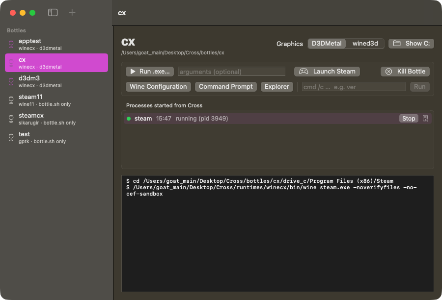
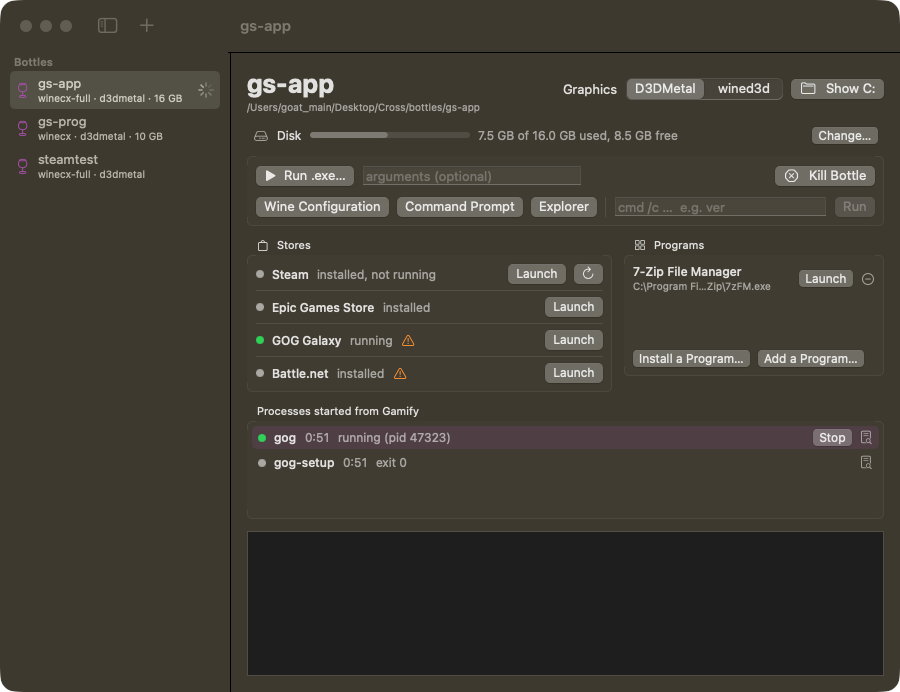

# Cross.app: the macOS GUI (2026-10-16)
> Renamed to **Gamify** on 2026-10-17 (bundle id local.gamify.app, app/build/Gamify.app, data in
> ~/Library/Application Support/Gamify, logs in ~/Library/Logs/Gamify). Paths below that say Cross.app
> or local.cross.app are the old names.

A SwiftUI bottle manager on top of the same code as the `cross` CLI. It does not
have its own launch logic: every action asks `CrossCore` for an `Invocation` (program,
argv, envp, cwd). `cross` `execve()`s it and the app `posix_spawn()`s it.



## Build and run

```sh
app/build.sh            # swift build -c release + wraps it into app/build/Cross.app
open app/build/Cross.app
```

- No Xcode project. `app/` is a Swift Package (swift-tools 5.9, macOS 14, executable
  target `CrossApp`) with a local dependency on `../cli` (product `CrossCore`).
  `build.sh` copies the binary into `build/Cross.app/Contents/MacOS/CrossApp`, adds
  `app/Info.plist` (bundle id `local.cross.app`) and signs it ad-hoc. `swift build` in
  `app/` alone builds the bare executable. Release build takes about 6 s.
- The app finds the checkout like the CLI does: it walks up from its own binary
  (`Project.locate`). Keep the bundle inside the repo, or set the root in
  Settings > Paths (stored in the `crossRoot` user default and passed to
  `Project.locate` as `CROSS_ROOT`, never to Wine).
- **macOS asks "Cross.app would like to access files in your Desktop folder"**,
  because the checkout lives on ~/Desktop. The app's first file access blocks until
  someone answers. The lookup runs off the main thread, so the window shows
  "Opening the Cross checkout…" in the meantime. With a plain ad-hoc signature,
  TCC pins the grant to the cdhash, so **every rebuild asked again**: an unanswered
  prompt left the first test launches with no window for minutes (main thread stuck in
  the TCC call). `build.sh` therefore signs with an explicit designated requirement
  `identifier "local.cross.app"`, so one Allow survives rebuilds (verified 2026-10-17: after one Allow, a debug build, i.e. a different binary, opened without a prompt).
  `CROSS_SIGN_IDENTITY=<identity> app/build.sh` signs with a real certificate instead
  (this machine has none).
- The first launch of a new build can take a few extra seconds anyway (system checks
  of the new binary).

## Structure

```
cli/Package.swift                 products: executable `cross`, library `CrossCore`
cli/Sources/CrossCore/
  Project.swift    root lookup (CROSS_ROOT, walk up from the binary, then the cwd)
  Runtime.swift    winecx + D3DMetal environment (= scripts/winecx-env.sh)
  Bottle.swift     bottles/<name>, cross.json + .runtime fallback, list/load/save
                   (image-backed bottles are mounted here, see "Disk allocation")
  Storage.swift    per-bottle disk images: DiskImage (hdiutil), mount/unmount, resize,
                   move to/from an image, delete, requireIdle (see "Disk allocation")
  Steam.swift      webhelper shim, ActiveProcess reset, lock cleanup, installer location,
                   bootstrap check (isBootstrapped, webhelperLog)
  SteamStatus.swift  Steam.status(in:): the bottle's Steam processes (libproc) + the newest
                   state of logs/connection_log.txt, and stuckReason (see "Steam status")
  SteamLibrary.swift  what Steam keeps on disk: KeyValues (.acf/.vdf text), installed apps
                   (appmanifest_*.acf in every library), installedApp(containing:), the
                   account (config/loginusers.vdf), licences (binary appcache/packageinfo.vdf)
  SteamCheck.swift Steam.check (see "Steam check"), the probe launch (steamProbe), runCapturing,
                   programLaunch (Steam games through steam://rungameid)
  Store.swift      Store model (Steam, Epic, GOG Galaxy, Battle.net): installer source and
                   cache, silent install, launcher, workarounds, running check; storeInstaller,
                   storeLaunch, installer (any .exe/.msi); CLI helpers runLogged,
                   bootstrapSteamWaiting (see "Stores and programs")
  Programs.swift   the Programs list: .lnk parser (ShellLink), Start Menu/Desktop scan,
                   programs.json, snapshot + recordInstall after an installer
  Process.swift    execReplacing / runWaiting / Invocation / spawnDetached / Termination
  Updater.swift    self-update: latest.json check, download + SHA-256, staging, detached
                   install helper (docs/updates.md)
  Commands.swift   one function per CLI command, returning an Invocation:
                   loadBottle, createBottle + wineboot, runExe, wineCommand, steam,
                   steamInstaller, steamBootstrap, steamShutdown, waitForBottle, kill,
                   environmentLines
cli/Sources/cross/main.swift      argument parsing + printing only
app/Sources/CrossApp/
  CrossApp.swift   App, AppDelegate (files opened with the app), sidebar, New Bottle sheet
  AppModel.swift   bottles, jobs (processes started from the app), all actions
  BottleView.swift bottle page: Disk row, actions, graphics picker, Stores box (Steam row
                   with its status), process list, log; StorageSheet, StorageSizeField
  AppModel+SteamCheck.swift  checkSteam (Steam.check off the main thread)
  SteamCheckView.swift  the Check… sheet on the Steam row
  AppModel+Stores.swift  installStore / launchStore, installProgram / addProgram /
                   removeProgram / launchProgram, refreshStoresAndPrograms, InstallPrompt
  ProgramsView.swift  the Programs box (list, Install a Program…, Add a Program… sheet)
  LogView.swift    NSTextView that tails the selected job's log file
  SettingsView.swift  General tab (tutorial), Environment tab (= `cross env`), Paths tab
  TutorialView.swift  first-run tutorial window (six steps, see below)
  Updates.swift    UpdateController (launch check, Check for Updates…), the update banner,
                   Settings > General > Updates (docs/updates.md)
```

### CLI refactor check
`cross` behaves byte-for-byte as before the split. A script ran 21 invocations (usage,
`--help`, `bottle list`, `env cx`, `env cx --export`, `WINECX_GRAPHICS=wined3d|bogus`,
`WINEDEBUG`/`MTL_HUD_ENABLED` overrides, a non-winecx bottle, a missing bottle, every
missing-argument and unknown-option error) against the old binary and the new one,
copied to the same path (zsh puts the binary path in `$_`). All 42 stdout/stderr+exit
files were identical, both after the plain split and after main.swift moved onto
`Commands.swift`. `cross cmd cx /c ver` still prints Windows 10.0.19043.

### Process semantics in the app
`spawnDetached(_:output:onExit:)` (CrossCore/Process.swift): `posix_spawn` with
argv[0] = program and exactly the Invocation's envp. The cwd is set with
`posix_spawn_file_actions_addchdir_np` (as `cross run` chdirs before execve). stdin
is /dev/null, and stdout+stderr are appended to a log file. The child gets its own
process group, default signal handlers, an empty signal mask and
`POSIX_SPAWN_CLOEXEC_DEFAULT`. A background thread `waitpid`s and reports
`Termination` (exit code or signal). Output goes to a **file, not a pipe**, so a game or
Steam keeps running and logging after the app quits. This was checked: Steam's
`wine steam.exe` was reparented to launchd and stayed up. `cross bottle create`
(wineboot) and `bottle delete` use the same functions as the CLI.

Logs: `~/Library/Logs/Cross/<bottle>/<yyyyMMdd-HHmmss>-<label>.log`, starting with
`$ cd <cwd>` and `$ <program> <args>` lines written by the app.

The environment is inherited from the app's own process, as `cross` inherits the
shell's. From Finder that is launchd's environment. **`open` from a shell passes that
shell's whole environment** (including any tokens in it) to the app and so to Wine.
For a Finder-like launch from a terminal:
`env -i HOME=$HOME USER=$USER TMPDIR=$TMPDIR PATH=/usr/bin:/bin:/usr/sbin:/sbin open app/build/Cross.app`.

## What works (verified 2026-10-16, macOS 27.0.1, M4 Max)

- Build: `app/build.sh` with no warnings. The app launches, and window ids come from
  `scripts/listwindows.swift`. Screenshots are in docs/screenshots/.
- Sidebar: every directory in bottles/, settings from cross.json with the .runtime
  fallback (exactly `Bottle.list`, as in `cross bottle list`). Non-winecx bottles
  (steam11, steamcx, test) are listed as "bottle.sh only", with actions disabled. The
  list reloads when the app becomes active and on ⌘R.
- **Create bottle** (+ button: name, runtime winecx, graphics D3DMetal/wined3d): created
  `bottles/apptest` with `{"graphics":"wined3d","runtime":"winecx"}` plus `.runtime`.
  wineboot ran as a job with its log while the UI stayed usable. Afterwards
  `cross bottle list` shows it and `cross cmd apptest /c ver` works.
- **Graphics picker** (segmented, in the bottle header) rewrites cross.json
  (apptest switched to d3dmetal, sidebar updated). It applies to programs started
  afterwards.
- **Launch Steam in `cx`**: the same steps as `cross steam` (shim install, ActiveProcess
  reset via regedit, lock cleanup, `steam.exe -noverifyfiles -no-cef-sandbox`, cwd
  = Steam dir) ran off the main thread. The "Sign in to Steam" window appeared after
  about 4 s, then Steam auto-logged in and rendered the store
  ([screenshot](screenshots/steam-cx-from-app.png)). `lsof` confirmed the webhelper
  belonged to bottles/cx.
- **Run .exe**: the open panel starts in the bottle's drive_c and takes optional
  arguments. The same code path runs for an .exe dropped on a bottle page or opened
  with the app (`open -a app/build/Cross.app game.exe`, which runs it in the selected
  bottle; Info.plist declares `com.microsoft.windows-executable` as a Viewer type).
  Verified with `src/d3dtest/d3d11test.exe` in apptest: cwd = its dir, log shows
  "AMD Compatibility Mode", feature level 11_0, 120 frames at 59.7 fps (D3DMetal).
- **cmd**: "Command Prompt" opens Wine's console window (`wineconsole cmd`, because the
  CLI's `cross cmd` needs a terminal). The `cmd /c …` field runs a line with its output
  in the log: `ver` gives Windows 10.0.19043, exit 0.
- **Wine Configuration** (winecfg) and **Explorer** open their windows.
- **Kill Bottle** (`wineserver -k`) closed winecfg and the console in apptest. Per-job
  **Stop** sends SIGTERM to that process only.
- **Settings > Environment**: `Runtime.environmentLines`, the function `cross env`
  prints with, for any winecx bottle, with the `--export` format toggle. The
  "only variables Cross sets" filter (on by default) hides inherited variables. With
  it off, the output is the full `cross env`.
- **Settings > Paths**: root, runtime, D3DMetal, wined3d, shim and logs paths with
  existence checks, plus the root override.
- Delete bottle (sidebar context menu, with confirmation): `wineserver -k` + remove,
  like `cross bottle delete`.

## Not done / stubbed

- **Install Steam: verified end to end (2026-10-16) in `apptest`, from app buttons
  only.** One click on Install Steam ends at a rendered "Sign in to Steam" window
  ([screenshot](screenshots/steam-apptest-install-from-app.png)), about a minute with the
  cached installer. What was found and changed:
  - `SteamSetup.exe /S` (exit 0, ~3 s) installs only the 7 MB bootstrapper
    (`Steam.exe`, `bin`, `public`, `uninstall.exe`; no `bin/cef`).
  - The normal launch (`steam.exe -noverifyfiles -no-cef-sandbox`) **cannot** bootstrap:
    with -noverifyfiles the bootstrapper logs "Verification skipped", downloads
    nothing and shows a "Steam - Fatal Error" box. So "Launch Steam twice" would not
    have helped.
  - Without -noverifyfiles the first start downloads and installs the win32 then
    win64 client (~1.7 GB), restarting itself twice (the first wine process exits 42),
    then starts Valve's `steamwebhelper.exe`: "Sign in to Steam" appears but is black,
    as expected without the shim. `steam.exe -shutdown` + `wineserver -w` end it in
    about 6 s; the next normal launch installs the shim and renders.
  - The app now chains this. Install Steam: steam-setup job, then (exit 0) the
    **steam-bootstrap** job (`Runtime.steamBootstrap`: ActiveProcess reset, lock
    cleanup, `steam.exe -no-cef-sandbox`). It waits until `bin/cef/cef.win*` has a
    webhelper and `logs/webhelper.txt` ("webhelper launched") was written after the
    launch, plus 5 s, then runs **steam-shutdown** (`steam.exe -shutdown`),
    **wineserver-w** (`wineserver -w`) and the normal **steam** launch (shim, flags).
    Launch Steam on an installed but not bootstrapped bottle runs the same chain.
    While it runs the button reads "Setting up Steam…" and is disabled. Each step has
    its own log; the bootstrap log ends with "cross: client bootstrapped; restarting
    Steam with the webhelper shim". `lsof` confirmed the running webhelper is the shim
    from bottles/apptest.
  - Limits: the wait gives up after 30 min (alert, then Launch Steam retries).
    `wineserver -w` also waits for anything else running in the bottle (winecfg, a
    console). Not logged in, so the first post-login update was not exercised.
  - The CLI is unchanged: `cross steam` on a fresh install still launches with
    -noverifyfiles and hits the Fatal Error (fix by running
    `cross run <bottle> ".../Steam/steam.exe" -no-cef-sandbox` once, then
    `steam.exe -shutdown`). CrossCore only gained new functions; main.swift and the
    existing functions are untouched, so `cross` output is the same.
- I did not click through the open panel itself: it runs in a separate system process.
  Its code path is the same as drag-drop/`open -a`, which was verified.
- Only the winecx runtime is driven, same as the CLI. Bottles on gptk/wine11/sikarugir
  are shown read-only.
- Program list since 2026-10-20 (see "Stores and programs"); still no icons, no
  winetricks/DLL overrides UI, no per-bottle env overrides (WINEDEBUG, MTL_HUD_ENABLED etc. come only from the
  app's environment), no app icon.
- The job list is in memory only; logs stay on disk. A game started by Steam is
  Steam's child, not a job, so use Kill Bottle for it.
- The app bundle must stay inside the checkout, or have its root set in Settings.
  There is no installer or notarization.


## Runtimes (2026-10-17)
The app and the CLI drive every runtime in `Runtime.known` (winecx, winecx-full). The New
Bottle sheet offers the runtimes whose build exists (`Runtime.available(in:)`); a bottle keeps
the runtime in its cross.json and every launch resolves it with `Runtime.loadBottle(_:in:)`.
Settings > Runtimes shows both homes. winecx-full adds the GStreamer plugin variables.

## First-run tutorial (2026-10-17)

A six-step walkthrough in its own window ("Welcome to Cross", SwiftUI `Window` scene
with id `tutorial`, 640×600, not a sheet: the main window stays usable, so the bottle
the tutorial creates shows up in the sidebar while wineboot runs). Back / Next / Skip
Tutorial in the footer, Finish on the last step. Code: `app/Sources/CrossApp/TutorialView.swift`,
hooks in `AppModel` (`shouldOpenTutorialAtLaunch`, `newBottleNameError`,
`suggestedBottleName`, `installRosetta`, `recheckRosetta`; `createBottle` now returns its
wineboot `Job`). Written for someone who got the .app and knows nothing:
no paths of the checkout, no Wine jargon.

| Step | Content | Adapts to |
|---|---|---|
| 1 Welcome | What Cross is (Wine + D3DMetal, through Rosetta), what works (DX9–12, Steam, plain .exe) and what does not (kernel anti-cheat, drivers). | – |
| 2 Rosetta 2 | Why it is needed. | Installed (`Runtime.rosettaAvailable`): green check. Missing: **Install Rosetta 2…** runs `softwareupdate --install-rosetta --agree-to-license` through `NSAppleScript` "with administrator privileges" (the standard macOS password dialog), then `Runtime.recheckRosetta()`; when that returns true the tutorial moves on to the bottle step by itself. Also the command with Copy and **Check Again** buttons for a Terminal install. |
| 3 Bottles | What a bottle is (including its own disk of a chosen size, 64 GB to start). | No drivable bottle: "Create your first bottle" (name field, default `games`/`games2`…, runtime = `Runtime.preferred`, D3DMetal, disk = `Runtime.defaultStorageGB`; the runtime line is hidden when only one runtime is available). Bottles exist: a popup to pick one (with "Steam installed" hints) or "Create a new bottle". **Create Bottle** calls `AppModel.createBottle` and shows the wineboot job's status line and log inline. Rosetta or runtime missing: a warning instead of the form. |
| 4 Steam | What Install Steam does (installer, first start with the 1.7 GB client download and a black window, restart, sign-in window; Cross never sees the password). | Bottle from step 3 with no Steam: **Install Steam** (disabled while its wineboot still runs) = `AppModel.installSteam`, then the step shows the latest job's status and log while `steamSetup` contains the bottle. Steam installed: "already installed" (or "installed, sign in" when started from the tutorial) with a Launch Steam button. No bottle chosen: a hint. |
| 5 Run a game | Launch Steam, Run .exe…, drag-and-drop / open with Cross; graphics picker, winecfg/cmd/Explorer, Kill Bottle. | – |
| 6 Where things live | Bottles (`Project.bottles`), Logs (`~/Library/Logs/Cross`), Downloads (`Project.downloads`), each with a Show-in-Finder button; Settings (SettingsLink). Finish. | Paths come from the located project, so a bundled app shows Application Support, not a checkout. |

When it shows:
- First launch: `AppModel.shouldOpenTutorialAtLaunch()` returns true when the user default
  `tutorialShown` (domain `local.cross.app`) is not set, and sets it right away (closing the
  window counts as seen). `ContentView` opens the window once `isLocating` is false, i.e.
  after the Desktop-folder permission prompt, so the bottle step has a project.
- Replay: **Help > Cross Tutorial** (`TutorialCommands`) or **Settings > General > Show
  Tutorial Again**. "Show on Next Launch" there clears the flag.
- Reset for testing: `defaults delete local.cross.app tutorialShown`, or launch with
  `CROSS_RESET_TUTORIAL=1` in the environment (AppModel.init removes the key), e.g.
  `env -i HOME=$HOME USER=$USER TMPDIR=$TMPDIR PATH=/usr/bin:/bin:/usr/sbin:/sbin CROSS_RESET_TUTORIAL=1 open app/build/Cross.app`.

Verified 2026-10-17 (release build, `CROSS_RESET_TUTORIAL=1`, driven with System Events
clicks on the footer buttons): every step rendered
([1](screenshots/tutorial-1-welcome.png), [2](screenshots/tutorial-2-rosetta.png),
[3 pick](screenshots/tutorial-3-bottles-pick.png), [3 create](screenshots/tutorial-3-bottles-create.png),
[3 creating](screenshots/tutorial-3-bottles-creating.png), [3 created](screenshots/tutorial-3-bottles-created.png),
[4 install](screenshots/tutorial-4-steam-install.png), [4 progress](screenshots/tutorial-4-steam-progress.png),
[4 done](screenshots/tutorial-4-steam-done.png), [5](screenshots/tutorial-5-run.png),
[6](screenshots/tutorial-6-locations.png)). Create Bottle made `bottles/games`
(`{"graphics":"d3dmetal","runtime":"winecx"}`), wineboot exit 0 in about 15 s with its log in
the tutorial, the bottle selected in the main window and listed by `cross bottle list`.
Install Steam from the tutorial ran the steam-setup → steam-bootstrap → steam-shutdown →
wineserver-w → steam chain in `games` with the bootstrap log tailing inside the step, and
ended about 50 s later (cached installer) at a rendered "Sign in to Steam" window
([screenshot](screenshots/tutorial-4-steam-signin.png)); the step then read "Steam is
installed in 'games' and should be showing its Sign in window". The Rosetta-missing branch could not be
exercised on this machine (Rosetta is installed); its install path is the documented
`NSAppleScript` call followed by `Runtime.recheckRosetta()`. The New Bottle sheet also
defaults to `Runtime.preferred` and hides the Runtime picker when only one runtime is present.

Settings > Paths was reorganised for the packaged app
([screenshot](screenshots/settings-paths.png)): "Your data" (`Project.bottles`,
`Project.downloads`, logs), "Runtime" (only the available runtimes, D3DMetal, wined3d, the
shim, `Project.notices`, Rosetta 2 state) and "App" (bundled: just the runtime files
location) or "Checkout" (root plus the root override, shown only when not bundled).


## Steam status, stuck detection and Restart Steam (2026-10-17)

Background: a Steam that lost its connection (Mac asleep, network change) does not
recover by itself, and `steam.exe` is single-instance per prefix, so Launch Steam only
forwarded to the stale client: the user saw "NO CONNECTION" while the Mac, the account
and Wine's networking were fine. A `steamwebhelper_real.exe` can also outlive a crashed
or killed `steam.exe`. `cross kill cx` + a normal launch fixed it. The app now does that
itself, without the user knowing what wineserver is.

### CrossCore: `Steam.status(in:)` (`cli/Sources/CrossCore/SteamStatus.swift`)
- **Processes** (`Steam.processes(in:)`): every process whose working directory is inside
  the bottle's prefix, found with libproc (`proc_listallpids`,
  `proc_pidinfo(PROC_PIDVNODEPATHINFO)` for the cwd, `PROC_PIDTBSDINFO` for the start
  time) and `sysctl KERN_PROCARGS2` for the Windows command line. The environment of a
  Rosetta process is not readable from another process (`ps -E` shows nothing for them),
  but Wine keeps the unix cwd inside the prefix: `steam.exe` runs in its Steam dir and
  the webhelpers inherit it, `C:\windows\...` services run in drive_c/windows.
  `steam.exe -shutdown` requests are not counted as Steam. About 10 ms for 1000 pids.
  `Processes.hasOrphanWebhelper`: webhelper processes but no `steam.exe`.
- **Connection** (`Steam.connection(in:)`): the newest line of
  `Program Files (x86)/Steam/logs/connection_log.txt` that carries a state, i.e.
  `[2026-10-17 13:23:40] [Logged On, 4, 7] [U:1:…] …`. Only the last 128 KB are read;
  Steam rotates the file on start, so the newest session is always in it. States seen in
  cx: Connecting, Connected, Logging On, Logged On, Logging Off, Logged Off.
  `ConnectionState`: `.loggedOn`, `.connecting` (Connecting/Connected/Logging On) and
  `.loggedOff(name)` for everything else ("Logged Off", "No Connection", …), plus the
  reason when the log gives one ("Session Replaced", "Disconnected By Remote Host").
  The file has CRLF line endings; Swift treats `\r\n` as one Character, so the parser
  splits on `isNewline`, not on `"\n"` (that bug returned nil on the first try).
- **`Status.stuckReason`** (plain English, shown to the user):
  - an orphaned webhelper: "Steam's window process is still running, but Steam itself has quit.";
  - `steam.exe` older than 90 s (`Status.startupGrace`) and the newest state is
    `.loggedOff` with a timestamp after the process start: "Steam lost its connection at
    15:48 (Session Replaced).";
  - `.connecting` for more than 90 s: "Steam has been trying to connect since …".
  A fresh start is never stuck: the previous session's "Logged Off" line is older than
  the process, and the 90 s grace covers the connect. The 2026-10-17 incident would have
  matched the second rule: the newest state line was "Logged Off … Session Replaced" from
  the previous day, written after that steam.exe started, and the hourly
  `CClientJobGetClientUpdateHosts: failed to get updated list, error 3` lines that
  followed carry no state.

### App
- **Restart Steam** (`AppModel.restartSteam`), the button next to Launch Steam, with a job
  per step so the list shows the progress: `steam-shutdown` (`steam.exe -shutdown`),
  `wineserver-w` (up to 20 s, then the job is stopped), `wineserver-k` (to be sure: a
  stuck client or an orphan does not react to -shutdown), a second `wineserver-w` (up to
  10 s, so the new Steam does not race the dying server), then the normal `steam` launch
  (shim, ActiveProcess reset, lock cleanup). While it runs the button reads "Restarting
  Steam…" and the status line "Steam: restarting…" (`steamRestarting`).
- **Launch Steam checks first** (`AppModel.launchSteam`): when the client is bootstrapped
  it reads `Steam.status` off the main thread; if `stuckReason` is set the bottle page shows
  the alert "Steam looks stuck" with the reason and "Restart it? Steam quits and starts again;
  nothing is lost." (Restart Steam / Cancel, `steamStuckPrompt`). Otherwise the launch runs
  as before (a healthy running Steam just gets its window raised by the forwarding).
- **Status line** under the actions on the bottle page (only when Steam is installed):
  "Steam: installed, not running" / "running, starting…" (no state line yet for this
  process) / "running, connecting…" / "running, online" / "running, offline since 15:48" /
  "not running properly" (orphan), with a dot (grey, orange, green, red) and, when
  `stuckReason` is set, the reason and a small Restart Steam button. `BottleView` refreshes
  `model.steamStatus[bottle]` every 3 s in a `.task(id:)` loop while the page is shown.
- **Tutorial**, Steam step: one sentence pointing at Restart Steam for a Steam that shows
  "No connection" or stops responding.
- The CLI is unchanged (CrossCore only gained `SteamStatus.swift`).

### Verification status (2026-10-17, bottle `steamtest`)
`bottles/cx` (and every other bottle) disappeared from `bottles/` at 13:36:45 while this was
being built: the user had deleted them to free disk space (confirmed afterwards). With
the parent session's OK a new bottle **`steamtest`** (winecx, D3DMetal) was created with the
CLI and Steam installed from the app's Install Steam button (setup → bootstrap → shutdown →
wineserver -w → steam, about a minute, ending at "Sign in to Steam"). Everything below was
first verified signed out; the signed-in case was verified afterwards, see the last bullet.

Verified in the app (release build, driven with System Events clicks and screenshots):
- **Signed-in re-logon (verified 2026-10-17 14:47)**: with the user signed in to Steam in
  `steamtest` (logon 'OK' at 14:20), steam.exe was killed with
  `pkill -f 'steam.exe -noverifyfiles'` (the status line went to "installed, not running"),
  then Restart Steam was clicked in the app: jobs steam-shutdown, wineserver-w, wineserver-k,
  wineserver-w, steam ran in order, and connection_log.txt showed a fresh
  `LogOn() called` → `ConnectionCompleted` → `RecvMsgClientLogOnResponse() : 'OK'` three
  seconds after the new steam.exe started; the status line read "Steam: running, online"
  (green). Steam's saved refresh token survives the restart, so no sign-in is needed.
- **Status line**: "Steam: installed, not running", then after Launch Steam
  "Steam: running, connecting…" with the orange dot
  ([screenshot](screenshots/steam-status-running.png)); on the current build the signed-out
  states read "running, not signed in" (connection lines carry `[U:1:0]`).
- **Orphaned webhelper**: `pkill` of steam.exe takes the webhelper down with it at the
  sign-in window (SIGTERM and SIGKILL alike), unlike the incident on the signed-in cx. The
  orphan was reproduced by starting `steamwebhelper_real.exe --disable-gpu --single-process`
  alone in the bottle (`cross run`): `Steam.status` reported `orphan: true`, the status line
  turned red, "Steam: not running properly", with the reason and a Restart Steam button
  ([screenshot](screenshots/steam-status-stuck.png)).
- **Launch Steam on the stuck bottle** showed the alert "Steam looks stuck" with the reason
  and Restart Steam / Cancel ([screenshot](screenshots/steam-stuck-alert.png)); it waits for
  the click (checked for 24 s with no input: no job started). Restart Steam is the default
  button (Return accepts it).
- **Restart Steam** from the alert: no steam.exe, so the `-shutdown` step is skipped;
  `wineserver-w` ran into its 20 s limit (the orphan ignores -w) and was stopped (shows as
  "signal 15"), `wineserver-k` exit 0, the second `wineserver-w` exit 0 at once, then the
  `steam` job; the button read "Restarting Steam…" and the status line "Steam: restarting…"
  ([screenshot](screenshots/steam-restarting.png)). The "Sign in to Steam" window was back
  28 s after the click, `Steam.status` found steam.exe plus two webhelpers, the status line
  read "running, connecting…" ([screenshot](screenshots/steam-restarted.png)).
- **Log parser** on the real cx excerpts (CRLF): "Session Replaced" → loggedOff with that
  reason and the account; "user initiated logoff" → loggedOff, `isSignedOut`; `[U:1:0]` →
  no account. On the live cx before it vanished: steam.exe + 2 webhelpers found, "Logged On
  at 13:23:40", not stuck, 8 ms.

Found on the way:
- **`steam.exe -shutdown` with no client running starts the bootstrapper**, which verifies
  the whole install (no -noverifyfiles) for 3-4 minutes. `restartSteam` therefore runs the
  shutdown step only when a steam.exe is running, and stops it after 15 s.
- **After an unclean end Steam's next start often quits by itself** after 2-3 s: the job log
  shows "Looks like steam didn't shutdown cleanly, scheduling immediate update check",
  "Nothing to do", "Verification skipped", "Shutdown"; the start after that works. Seen on
  three of four starts after a kill or wineserver -k today. `startSteamAgainIfItQuits`
  (used by Launch Steam and by the restart's final step) watches the `steam` job for 15 s
  and starts it once more when it ended with no steam.exe left (log line "cross: Steam quit
  right after starting …"). While it watches, the button stays "Restarting Steam…".
- The `.alert` is not reachable through System Events (no sheet, no window); it was
  accepted with a Return keystroke. `click at {x,y}` needs assistive access for osascript.
- The user was clicking in the app during the first run (Restart Steam twice, Kill Bottle
  twice, windows moved between displays), which produced overlapping job chains in the
  logs of 13:45-13:49; nothing in them is a bug of the chain itself.

## Disk allocation (2026-10-19)

A bottle can get its own disk of a chosen size, like a VM's virtual disk, instead of a
folder that grows without limit. New bottles get one by default (64 GB, or the free
space when the disk has less); existing bottles stay plain folders and load unchanged.

### Design

An image-backed bottle `foo` is an APFS sparse bundle next to its mount point:

```
bottles/foo.sparsebundle      hdiutil create -type SPARSEBUNDLE -fs APFS -size 64g -volname foo
                              + hdiutil resize -size 64g (a fresh image's volume is ~200 MB
                                short of -size; after the resize it is exactly 64 GiB)
bottles/foo/                  hdiutil attach -nobrowse -noautoopen -mountpoint bottles/foo
                              (not in Finder's sidebar, no window). While unmounted it holds
                              only .gamify-disk-image (the image's file name), written by
                              every mount, so a missing image is reported, not shown as an
                              empty folder bottle
bottles/foo/cross.json        inside the volume, as before, plus
                              "storage": {"image": "foo.sparsebundle", "sizeGB": 64}
bottles/foo/.metadata_never_index   keeps Spotlight off the volume (it would hold it busy)
```

- A bottle is image-backed exactly when `bottles/<name>.sparsebundle` exists; nothing else
  needs to be stored to find it (no sidecar file inside the bundle). The volume's own
  size (statfs) is the live value shown everywhere; `storage.sizeGB` records what was set.
- Sparse: the image takes only what was written (a fresh bottle: 1.7 GB). Deleting files
  inside the bottle does not shrink it by itself; `hdiutil compact` (run by every resize,
  also "resize" to the same size) gives the space back (0.2 s, reclaimed 8.2 GB in a test).
- Windows sees C: (drive_c on the volume) as a drive of the allocated size:
  `GetDiskFreeSpaceExW("C:\\")` = 10.00 GB for a 10 GB bottle, and a write past the end
  fails with ERROR_DISK_FULL (112). Wine's `fsutil` has no `volume diskfree` and WMI's
  `Win32_LogicalDisk.Size` is a constant (82252800000 for every drive); `dir C:\` shows
  the real free bytes.
- Units: whole GiB, called GB as hdiutil (`64g`) and Windows do. Minimum 8 GB, maximum
  what the bottle already uses plus the free space of the disk the image is on
  (`volumeAvailableCapacityForImportantUsage`, which counts purgeable space as Finder does:
  358 GB here while `df` said 51 GB).
- Mounting is lazy: `Bottle.load` and `Bottle.list` attach an image whose mount point is
  not a mount point (statfs `f_mntonname` == realpath of the prefix), so the CLI and the app
  work after a reboot or an `hdiutil detach`. `Bottle.list` shows image bottles even when
  they cannot be mounted (`Bottle.storageError`); the app shows an error page with Try
  Again, `cross bottle list` an "unavailable: …" column.
- Failure modes handled: image missing (marker left, error names the image); attach fails
  (error from hdiutil); image already mounted elsewhere (found with `hdiutil info -plist`,
  ejected and mounted at the bottle; if that eject fails because something uses it, the
  error says where it is mounted); files in the unmounted mount point (refused, they would
  be hidden under the volume).

### Operations (CrossCore `Storage.swift`, used by the CLI and the app)

| Operation | Steps |
|---|---|
| create (`createBottle(name:config:storageGB:)`) | range check, image create + resize, marker, attach, cross.json, then wineboot as before |
| resize (`resizeStorage`) | `requireIdle`, check the range (shrink only to at least the used space, rounded, plus 1 GB), detach, `hdiutil resize -limits` minimum when shrinking, `hdiutil resize -size Ng`, `hdiutil compact`, attach (also after a failed resize), update `storage.sizeGB` |
| folder -> image (`moveToImage`) | `requireIdle`, measure the folder, need its size + 1 GB free, create the image and attach it at `bottles/.<name>.moving`, `ditto` (keeps dosdevices symlinks, modes, xattrs), compare both trees (every relative path with kind, file size and symlink target), detach, rename the folder to `bottles/.<name>.folder`, mount the image at the bottle, write `storage`, remove the backup. A failure before the swap removes the image and leaves the folder untouched; after it, the folder is put back |
| image -> folder (`moveToFolder`) | `requireIdle`, `ditto` the volume into `bottles/.<name>.moving`, compare, eject, move the image aside, swap the folder in, drop `storage`, delete the image |
| delete (`deleteBottle`) | `wineserver -k` (+ `-w` for images), eject (forced if need be), remove the image and the mount point |

`requireIdle` refuses while Windows programs run in the bottle: processes whose cwd is in
the prefix (`Steam.bottleProcesses`) and, for programs started from elsewhere (a `cross
cmd` from a shell keeps the shell's cwd), the bottle's wineserver answering on
`/tmp/.wine-<uid>/server-<dev>-<inode>/socket` (connect succeeds only while it runs). A
server that only lingers after its last program is waited for up to 10 s (it writes the
registry files when it exits, so the volume must not be ejected under it).

hdiutil notes (macOS 27.0.1): every `hdiutil create/attach/detach/resize` prints a warning
that it is deprecated in favour of `diskutil image …`, and still works; CrossCore filters
the warning out of error messages. `hdiutil resize` on an attached image fails with
"Resource temporarily unavailable (35)", by path and by /dev/disk, hence detach first; it
takes ~0.4 s and the APFS container and volume follow (grow and shrink). Attaching an image
that is attached at another mount point fails with "Resource busy"; at the same mount point
it is a no-op. All of it runs as the normal user (no sudo).

### CLI

```
cross bottle create <name> [--storage <GB>|unlimited]   (default 64 GB, capped by free space)
cross bottle set <name> storage <GB>      resize an image bottle, or move a folder bottle into a new image
cross bottle set <name> storage unlimited move an image bottle back into a folder
cross bottle set <name> --storage <GB>    same
cross bottle list                         last column: folder (no limit) | image 1.7 GB used of 10.0 GB | unavailable: …
cross bottle delete <name>                also ejects and removes the image
```

### App

- **New Bottle sheet**: a Disk section with "Its own disk" (default) / "Unlimited (a plain
  folder)" and a Size row (slider over the allowed range, whole-GB field, stepper). Create
  is disabled outside the range. With less than 8 GB free only the folder is offered.
- **Bottle page**: a Disk row under the header. Image bottles: a bar with used / allocated
  and free ("1.7 GB of 10.0 GB used, 8.3 GB free"; orange above 75 %, red above 90 %),
  refreshed with the Steam status every 3 s (`AppModel.refreshStorage`), and **Change…**.
  Folder bottles: "Folder, no size limit · N GB free on this Mac" and **Move to a Disk
  Image…**. While an operation runs the row shows its step ("Creating a 9 GB disk image…",
  "Copying 3.2 GB of 11 GB…", "Verifying the copy…"), the sidebar shows the spinner, the
  action buttons are disabled and `AppModel.start` refuses launches in that bottle.
- **StorageSheet** (Change… / Move to a Disk Image…): the current use, the Size row, Resize
  or Move, and for image bottles **Move to a Folder (no size limit)**.
  `AppModel.setStorage` refuses with an alert while jobs, Windows processes or the
  bottle's wineserver run ("Quit them (or use Kill Bottle)"), then runs the CrossCore
  operation off the main thread.
- Sidebar subtitle: `winecx · d3dmetal · 10 GB` for image bottles, "disk image
  unavailable" when it cannot be mounted. Delete Bottle goes through `Runtime.deleteBottle`.

### Verified (2026-10-19, CROSS_BOTTLES in a scratch dir, runtimes from the checkout)

| Check | Result |
|---|---|
| `cross bottle create st10 --storage 10` | image + wineboot in 18 s; `bottle list`: image 1.7 GB used of 10.0 GB; bundle 1.7 GB on disk |
| Windows' view | `GetDiskFreeSpaceExW`: C: total 10.00 GB (10737418240 bytes), free 8.27 GB; `dir C:\`: 8,884,961,280 bytes free |
| write past the end | a test exe writing 9 GB to C:\big.bin: "WriteFile failed after 8.23 GB: error 112 (ERROR_DISK_FULL)"; the bottle kept working |
| grow | `cross bottle set st10 --storage 20`: 1.2 s, Windows C: total 20.00 GB |
| shrink | to 5: "below the minimum of 8 GB"; with 7.7 GB used, to 8: "below the minimum of 9 GB"; to 12: done, C: 12.00 GB; same size again: compacted 7.8 -> 1.7 GB on disk |
| busy | resize while `cross cmd st10 /c ping -n 25 …` ran (cwd outside the prefix): refused after 10 s ("its wineserver is still up"); afterwards it worked |
| reboot simulation | `hdiutil detach bottles/st10`, then `cross cmd st10 /c ver`: remounted, Windows 10.0.19043 |
| mounted elsewhere | `hdiutil attach -mountpoint elsewhere`: list ejected it and remounted at the bottle; with a shell cd'd into it: listed "unavailable: … already mounted at … cannot be ejected (… Resource busy)"; next list after the shell left: fine |
| stray files / missing image | a file in the unmounted mount point: refused with its name; image moved away: "the disk image of 'st10' (st10.sparsebundle) is missing"; moved back: fine |
| folder -> image -> folder | 1.7 GB folder bottle `fb` to a 9 GB image (7.6 s), C: 9.00 GB, exes ran; back to a folder (5 s), runs, cross.json without `storage`, nothing attached. A 5.7 GB folder bottle (4 GB payload) to a 12 GB image: 8.6 s, payload intact, C: 12.00 GB |
| delete | image bottle, image bottle mounted elsewhere, folder bottle: nothing left in bottles/, `hdiutil info` and `mount` show nothing |
| existing bottles | checkout `steamtest` (folder, 21 GB) and the 0.3 app's `Steam` bottle list as "folder (no limit)"; `cross cmd steamtest /c ver` runs; steamtest's cross.json byte-identical |
| app | `app/build.sh` builds; New Bottle sheet, bottle page (image and folder), StorageSheet, a move and a resize driven through `AppModel.setStorage`, the unavailable-image page and Delete Bottle checked with window screenshots (a test copy with its own bundle id, sheets opened by a temporary launch hook that is not committed) |

Not verified: converting a bottle above ~6 GB (the cx-sized 11 GB case). The Mac had
25 GB free during the test while the user's Steam download was filling the disk, so the
21 GB `steamtest` copy was not attempted; at the measured ~0.7 GB/s an 11 GB bottle
takes ~17 s plus the comparison. The tree comparison checks paths, kinds, sizes and
symlink targets, not file contents (ditto is trusted for the bytes). Clicking through
the sheets by hand was not done (no UI automation access); their actions were exercised
through the same AppModel calls.


## Stores and programs (2026-10-20)



### Stores
`Store` (cli/Sources/CrossCore/Store.swift) describes a launcher: official installer source
and its cache in `downloads/<id>/`, unattended install arguments, the launcher exe under C:
(first existing of a list), launch arguments, registry workarounds (written with regedit before
the install and before every launch), folders of stale locks to empty before a launch, the exe
names that mean "running" (a libproc scan of the bottle, as for Steam), plain-English notes and
a known issue. `Store.all` = steam, epic, gog, battlenet. Steam is in the list for the CLI and
the UI, but its install and launch keep their own code paths (`isSteam`): `steamInstaller` +
the bootstrap chain, `Runtime.steam` with the shim and `-noverifyfiles -no-cef-sandbox`,
`Steam.status`, Restart Steam; none of that changed.

| Store | Installer (checked 2026-10-19) | Install | Launcher | Workarounds | Result |
|---|---|---|---|---|---|
| Steam | `cdn.cloudflare.steamstatic.com/client/installer/SteamSetup.exe` | `/S` + bootstrap chain | `Program Files (x86)/Steam/steam.exe` | shim, flags (unchanged) | sign-in window |
| Epic Games Store | `launcher-public-service-prod06.ol.epicgames.com/launcher/api/installer/download/EpicGamesLauncherInstaller.msi` (303 to EpicInstaller-20.3.3.msi, 264 MB) | `msiexec /i … /passive /norestart`, 28 s | `Program Files/Epic Games/Launcher/Portal/Binaries/Win64/EpicGamesLauncher.exe -SkipBuildPatchPrereq` | none needed | first start self-updates (EpicGamesUpdater window, restart with -ForcedRestart), then **"Sign in to Epic Games" renders** ([screenshot](screenshots/store-epic-signin.png)) |
| GOG Galaxy | URL read from `remote-config.gog.com/components/webinstaller?component_version=2.0.0` (`content.windows.downloadLink`, now `content-system.gog.com/open_link/download?path=/open/galaxy/client/setup_galaxy_2.1.10.56.exe`, 342 MB, MD5 as published); that URL is also the fallback | Inno Setup `/VERYSILENT /SUPPRESSMSGBOXES /NORESTART`, 17-27 s | `Program Files/GOG Galaxy/GalaxyClient.exe` | `GalaxyOverlay.exe` disabled (CrossOver 25's profile); `ProgramData/GOG.com/Galaxy/lock-files` emptied before a launch | **launcher opens but its window stays blank** ([screenshot](screenshots/store-gog-blank.png)); its log says the login page loaded |
| Battle.net | `downloader.battle.net/download/getInstaller?os=win&installer=Battle.net-Setup.exe` (302 to `…/installer/win/1.0.66/Battle.net-Setup.exe`, 4.9 MB) | `--lang=enUS --installpath=C:\Program Files (x86)\Battle.net`; hands-off, 45 s, no clicks | `Program Files (x86)/Battle.net/Battle.net Launcher.exe` | `systemsurvey.exe` disabled (CrossOver 25's profile) | **launcher opens "Battle.net Login" but shows only its spinner** ([screenshot](screenshots/store-battlenet-spinner.png)) |

Install flow (CLI `cross store install`, app Install…): download once (via `<name>.part`),
registry workarounds, run the installer with its output in a job log, wait. Most installers are
done when they exit (GOG's starts Galaxy for a moment, which quits again, so "running" must not
end the wait). Battle.net-Setup.exe exits after ~4 s and finishes from a copy of itself in
`C:\ProgramData\Battle.net\Setup\bna_2` with its own progress window (`installerHandsOff`):
its install is done when the launcher is installed and running (20 min limit). The app then
launches a store that is not running yet; Battle.net starts itself.

Quirks found (Wine 10 / CrossOver 25.1 lineage, winecx-full, D3DMetal):
- **Epic**: works as is. The MSI installs the 64-bit launcher under `Program Files` (not x86).
  Its CEF (Chrome 90, EpicWebHelper.exe) renders through D3DMetal.
- **GOG Galaxy 2.1.10** is Qt 6 + Qt WebEngine. Its in-process Chromium GPU path runs ANGLE on
  D3D11; Wine's d3dcompiler_47 fails Skia's shaders (`E5005: Function "isinf" is not defined`).
  With Microsoft's d3dcompiler_47.dll in system32 (what CrossOver's "Game Launcher
  Dependencies" fetch from github.com/mozilla/fxc2) the shader errors are gone, but the window
  still stays blank. Also tried without success: `QTWEBENGINE_CHROMIUM_FLAGS=--disable-gpu`
  (Galaxy ignores it; the env reaches the process), `--disable-gpu` as an argument,
  `QT_QUICK_BACKEND=software`, `QT_D3D_NO_FLIP=0`, `QSG_RHI_BACKEND=opengl` (crashes), and the
  bottle on wined3d (ANGLE then needs GLES 3, gets 2: "too few uniforms", white window). So the
  native DLL is not shipped. After a kill the next start finds its own lock file
  (`GalaxyClient.exe-galaxy-client.lock`), logs "Second client instance detected" and quits;
  `storeLaunch` empties the folder first (verified: kill, launch, window back).
- **Battle.net 2.53** (`Battle.net.exe` and its libcef.dll are 32-bit, so D3DMetal, which is
  x86_64 only, does not apply): ANGLE D3D11 on Wine's 32-bit wined3d fails ("No available
  renderers"), the GLES 2 fallback is refused, SwiftShader-Vulkan lacks `VK_KHR_win32_surface`,
  and a CEF child dies with a breakpoint (winedbg "Program Error" dialog). Setting
  `"HardwareAcceleration": "false"` and `"QtHardwareAcceleration": "false"` in
  `AppData/Roaming/Battle.net/Battle.net.config` moves CEF to `--use-gl=disabled
  --disable-gpu-compositing` but the login still does not appear, so it is not applied.
  Lutris installs Battle.net with DXVK; a 32-bit DXVK over MoltenVK would be the next thing to try.
- CrossOver 25's crossover.tie profiles (downloads/crossover/…/share/crossover/data/crossover.tie)
  for all three: a "Game Launcher Dependencies" component (core fonts, VC++ 2015-2022 x64,
  d3dcompiler_47 from mozilla/fxc2, Asian fonts, msync) plus the per-store overrides above.
  Epic's and GOG's installers bring their own VC++ runtimes; nothing else of the component
  was needed for what is verified here.

### Programs
`Programs.list(in:)`: every `.lnk` under `ProgramData/Microsoft/Windows/Start Menu/Programs`,
the user's `AppData/Roaming/Microsoft/Windows/Start Menu/Programs`, `users/Public/Desktop` and
the user's Desktop whose target is an existing .exe (no uninstallers, no store launchers:
Steam started without its flags would undo the shim), plus `programs.json` next to cross.json:

```json
{"programs": [{"name": "7zFM", "exe": "C:\\Program Files\\7-Zip\\7zFM.exe", "arguments": "", "source": "installed"}],
 "hidden": ["c:\\program files\\7-zip\\7zg.exe|"]}
```

(kept apart from cross.json so program edits and bottle settings never touch each other;
`source` is `installed` or `manual`; `hidden` = shortcuts removed from the list, the .lnk stays).
The `.lnk` parser (`ShellLink`, [MS-SHLLINK]) takes the target from LinkInfo's local base path
(+ common path suffix; Wine writes only that, no ID list), else from the environment-variable
block, and reads the arguments. NSIS counts a terminating NUL in the arguments string (Steam's
shortcut has `"\0"` as arguments), so strings are trimmed. Windows paths map to unix through
`dosdevices/<drive>:`; launching is `runExe` (cwd = the exe's folder), arguments split like a
Windows command line.

After an installer (`cross install`, Install a Program…), `Programs.recordInstall` compares a
snapshot taken before it ran: new shortcuts show up by themselves; when there is none, the
windowed (PE subsystem 2) exes it added up to four levels below Program Files / Program Files
(x86) are stored as `installed` entries (at most three, shallowest first, no uninstallers,
updaters, crash reporters, setup or service exes).

App: the Programs box beside Stores, with Launch and Remove per entry, **Install a Program…**
(an open panel for .exe/.msi in ~/Downloads; .msi runs as `msiexec /i`) and **Add a Program…**
(an exe inside the bottle's C:, then a small sheet for name and arguments). Files opened with
the app or dropped on the page: an .msi or an .exe whose name contains setup/install gets the
alert "Install <file>?" with Install / Just Run / Cancel ([screenshot](screenshots/install-prompt.png));
other .exe files run as before.

### CLI
```
cross store list [<bottle>]                 stores, notes, known issues; installed/running in <bottle>
cross store install <bottle> <store>        download (once), workarounds, silent install, wait
cross store launch  <bottle> <store> [args] steam = cross steam; others: workarounds, locks, exe
cross install <bottle> <installer.exe|.msi> [args]   then prints the programs it added
cross programs <bottle>                     list (name, source, exe, arguments)
cross programs <bottle> launch <name> [args] | add <exe> [--name N] [args] | remove <name>
```
`cross store install <bottle> steam` runs SteamSetup.exe /S and then the same first start the
app does (`bootstrapSteamWaiting`: steam.exe without -noverifyfiles until the webhelper is
there, -shutdown, wineserver -w), so the CLI no longer leaves a bootstrapper that hits
"Steam - Fatal Error" on `cross steam`. Installer and bootstrap output goes to
`~/Library/Logs/Gamify/<bottle>/`, like the app's jobs. `cross steam` is unchanged.

### Verified (2026-10-19/20, test bottles in the checkout's bottles/, winecx-full, 16 GB images, all deleted afterwards)
| Check | Command / action | Result |
|---|---|---|
| Epic, CLI | `cross store install gs-epic epic` (cache empty) | downloaded 264 MB in 3 s, installed in 28 s; `cross store launch`: updater, then "Sign in to Epic Games" ~1.5 min after the launch |
| GOG, CLI | `cross store install gs-gog gog` (cache empty) | URL from the remote config, 342 MB in 5 s, installed in 22 s, override in the registry; launch: window "GOG GALAXY" 25 s later, blank; log "Showing login form"; kill + launch: stale lock cleared, window back |
| Battle.net, CLI | `cross store install gs-bnet battlenet` | 4.9 MB, hands-off install 45 s, "Battle.net Login" with spinner; `cross store launch` after a kill: same window 10 s later |
| Steam, CLI | `cross store install gs-steam steam` | setup + client bootstrap + shutdown in 48 s; `cross store launch gs-steam steam` and later `cross steam gs-steam`: "Sign in to Steam" in 10 s, webhelper_real with `--disable-gpu --single-process` |
| Program, CLI | `cross install gs-prog downloads/programs/7z2301-x64.exe /S` (7-Zip 23.01 from www.7-zip.org) | 2 s, "new program: 7-Zip File Manager (shortcut)"; `cross programs gs-prog launch "7-Zip File Manager"` opened 7-Zip ([screenshot](screenshots/program-7zip.png)) |
| no-shortcut fallback | same install with both Start Menu folders made read-only | 7zFM and 7zG stored as `installed` (7z.exe, a console tool, skipped); `remove 7zG`, `add … --name "7-Zip at C:" 'C:\'` listed as `manual` |
| App, Steam | Install Steam in fresh `gs-app` | the unchanged chain steam-setup → steam-bootstrap → steam-shutdown → wineserver-w → steam, "Sign in to Steam" 61 s after the start |
| App, stores | Install… for Epic, GOG, Battle.net; Launch for Steam and Epic | Epic: epic-setup 26 s then launched, sign-in rendered; GOG: gog-setup 52 s then the `gog` launch job, Galaxy window; Battle.net: battlenet-setup, then running; the rows' dots and states followed (screenshot above) |
| App, programs | Install a Program (7-Zip, /S), Launch from the list, an opened `7z2301-setup.exe` | 7-Zip File Manager listed and launched; the Install / Just Run alert appeared |

The app actions were driven through the same AppModel calls the buttons make, from a temporary
launch hook in a test copy of the app (own bundle id), not committed: System Events sees no
windows of the app on this machine (no assistive access), so clicks could not be scripted. The
alert's buttons and the open panels were therefore not clicked; Install / Just Run call
`installProgram` / `runExe`, which were exercised directly. Signing in was not attempted
(no accounts), so nothing after a login (game installs from the stores) is verified.

## Steam check and licences (2026-10-20)

Background: games started through Steam in Gamify ran as a demo (Dishonored 2 earlier,
Split Fiction in its Friend's Pass mode now), and the user wanted to know whether games
get their ownership information from Steam under our Wine. Findings (evidence in NOTES.md,
2026-10-20): Split Fiction runs as the Friend's Pass because the account's only licence for
app 2001120 is the free Friend's Pass package; Steam's answers to games are correct under
Wine; but Launch Steam on an already running Steam zeroed `ActiveProcess\pid`, after which
games built with older Steam SDKs could not start their Steam session. That is fixed, the
check repairs a bottle that still has it, and Steam games started from Gamify go through
Steam.

### The probe (`src/steam-probe`)
`steam-probe.exe [--fix] [--dll <steam_api64.dll>] <appid>...` (mingw-w64, `make -C
src/steam-probe`), run from C:\ProgramData\Gamify\steam-probe with a steam_api64.dll
copied from an installed game (the newest one; the client ships none) and steam_appid.txt
= 480 (Spacewar, owned by every account). It prints one `key: value` line per fact:
`active process` (ActiveProcess pid vs the live steam.exe, found with Toolhelp32; `--fix`
writes the right pid), `steam running` (SteamAPI_IsSteamRunning), `init` (SteamAPI_Init,
else InitSafe, else InitFlat), `logged on`, `steamid`, `appid`, the current app's
subscribed / free weekend / family sharing / owner, then
`app <id> subscribed=<0|1> installed=<0|1> purchased=<unix time>` per appid
(BIsSubscribedApp, BIsAppInstalled, GetEarliestPurchaseUnixTime). Interfaces are found by
name: `SteamAPI_SteamApps_v*` and friends (SDK 1.48+), else the old `SteamApps()` export,
else `SteamClient()` + `SteamAPI_ISteamClient_GetISteam*` with the version string from the
dll's data (or the known versions, newest first). Exit 0 = Steam answered, 2 = dll not
loadable, 3 = init failed, 4 = no ISteamApps. Spacewar shows as "playing" for a second.

### CrossCore `Steam.check(in:runtime:fix:)`
- Client: running (steam.exe by libproc) and the newest connection_log state (online /
  connecting / offline with the reason / at the sign-in window), the account name from
  config/loginusers.vdf (matched to the log's `[U:1:n]`; never the password, the file has
  none), `WantsOfflineMode`, stuckReason.
- Steam Client Service: steamservice.exe running in the bottle, else whether its service
  key is in system.reg. Under our Wine it is installed on the first start and Steam starts
  it (seen running on 2026-10-20); it does not carry licences either way.
- Game check (only while Steam runs): the probe with every installed appid (+480) and
  `--fix`; a stale ActiveProcess pid is reported as repaired (or as a problem with
  `--no-fix`).
- Per installed app (appmanifest_*.acf of every library in libraryfolders.vdf): Steam's
  live answer when there is one (subscribed=0 = no licence: demo or nothing), otherwise
  and in addition the licence kinds from packageinfo.vdf: the packages of the account's
  licence list that contain the app, classified by billing type and `extended` flags:
  bought (anything not free), Friend's Pass (`freeplaytogether`), free weekend,
  free promotion, free to play (billing 12), free. A Friend's Pass app is subscribed=1 for
  the Steam API too, so only the package tells it apart.
- How to launch: from Steam's library, or from Gamify (Programs / Run .exe), which starts
  a Steam game through Steam.

`cross steam check <bottle> [--no-fix]` prints it as text; the app's Steam row has a
**Check…** button that opens a sheet with the same items (icons per level, Check Again,
Copy Report). In a packaged app the probe lives in `Contents/Resources/steam-probe.exe`
(the app layer: adding it to root/src would change runtime-version and force a DMG update).

### Steam games through Steam (`Runtime.programLaunch`)
Run .exe, a Programs row and `cross programs <b> launch` start an exe that lies inside a
library's `steamapps/common/<installdir>` (and gets no extra arguments) as `steam.exe
-noverifyfiles -no-cef-sandbox steam://rungameid/<appid>` (`Runtime.steam`), like the
library's Play button: Steam runs its launch steps (cloud sync, install scripts, overlay,
playtime) and hands the game its app id. Run .exe on Steam's own steam.exe gets the same
launch as Launch Steam (with its flags, so the shim stays). `cross run` stays raw.

### ActiveProcess fix
`Runtime.steam` resets `HKCU\Software\Valve\Steam\ActiveProcess\pid` (stale pids after an
unclean exit made Steam quit, 2026-10-17) and clears the htmlcache locks only when no
steam.exe runs in the bottle. Before, a second Launch, a Restart that found Steam already
back, or any `steam://` URL zeroed the pid of the running client, which writes it only at
start; old steam_api dlls (SteamAPI_IsSteamRunning reads that pid) then failed
SteamAPI_Init for the rest of the session.

### Verified (2026-10-20, the user's `Steam` bottle, installed 0.5 app's runtime)
- `cross steam check Steam` with Steam running: client online as the account, Steam Client
  Service running, game check ok, Split Fiction "only the free Friend's Pass licence",
  228980 fine; 1.4 s. Again after zeroing the pid with `reg add`: `--no-fix` reports the
  wrong pid, the default run repairs it (`reg query` shows steam.exe's pid again).
- `cross steam check steamtest` (checkout bottle, Steam not running): cache-only answers,
  Portal 2 and Worms W.M.D owned.
- `programLaunch` (scratch package calling CrossCore, nothing launched): SplitFiction.exe ->
  `steam.exe -noverifyfiles -no-cef-sandbox steam://rungameid/2001120` in the Steam dir;
  with an argument -> the exe directly; steam.exe -> `Runtime.steam`.
- The Check… sheet compiles and builds (`app/build.sh`); it was not clicked through on
  screen (the user's desktop was in use).

