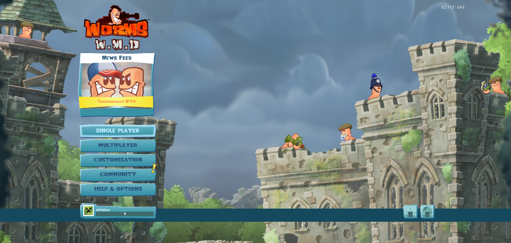
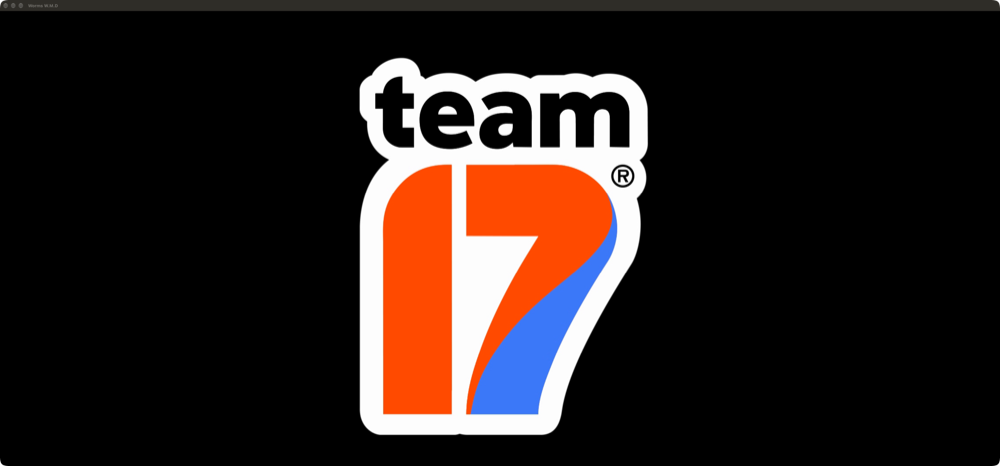
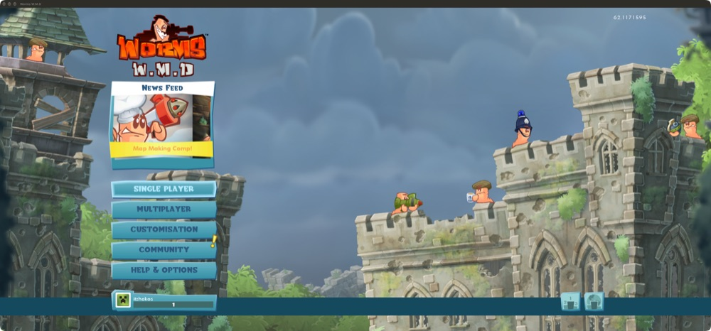

# Worms W.M.D: Qt5 + OpenGL under winemac (2026-10-17)

Symptom (user's MacBook, packaged Gamify.app; reproduced in bottle `steamtest`, runtime
winecx-full): Worms W.M.D (Steam AppID 327030, 32-bit, Team17's own engine "XOM" in a Qt 5
window, OpenGL) dies at startup with
`Unhandled page fault on read access to 00000000 at address 009EF860` (EIP in the game image,
`movb (%esi),%al` with ESI=0).

There were four problems in a row; each one hid the next. The first three are in Wine's Mac
driver and are fixed by `src/patches/winemac-qt5-opengl.patch`. The fourth (WMV video) was a
missing runtime feature, fixed on 2026-10-17 with FFmpeg + gst-libav in winecx-full (section 4).



(Main menu, rendered by the patched winemac.so; read back from the GL back buffer while the
screen was locked, intro videos re-encoded as described in section 4, before the WMV decoders existed.)

## 1. SetPixelFormat on a message-only window (the crash)

Trace (`WINEDEBUG=+wgl,+opengl,+seh,+win`):

```
trace:win:WIN_CreateWindowEx L"OpenGLDummyWindow" L"QtOpenGLDummyWindow" ... parent=FFFFFFFD
trace:wgl:set_pixel_format hdc 0x2901005a format 17
fixme:wgl:set_pixel_format DC for window 0x201f2 of other process: not implemented
warn:seh:OutputDebugStringW L"SetPixelFormat failed. (Invalid handle.)\n"
...  "XSOgl | DEFERRED RENDERER --> Device does not have enough draw buffers --> Only Supports [0]"
trace:opengl:glGetString name 7936          (GL_VENDOR)
trace:seh:handle_syscall_fault ... returning to user mode ... ret=c0000005
warn:opengl:glGetString glGetString returned 0xc0000005   (x3: VENDOR, RENDERER, VERSION)
trace:seh:dispatch_exception code=c0000005 ... addr=009EF860  esi=00000000 edi=0f9f5008
```

Qt 5 (`QWindowsContext::createDummyWindow`) creates its GL helper window, and the window
behind a QOffscreenSurface, with parent `HWND_MESSAGE`. Windows lets an app set a pixel format
on such a window and make a context current on it. winemac.drv never creates its per-window
data (`macdrv_win_data`) for message-only windows (`macdrv_create_win_data`: "don't create win
data for HWND_MESSAGE windows"), so `set_pixel_format` finds none and fails with the misleading
"other process" FIXME. No context becomes current, the unix `glGetString` faults, opengl32
returns NULL, and the engine copies the vendor string byte by byte from address 0.

The faulting instruction cannot be checked statically: the exe is SteamStub-protected (a
`.bind` section; `.text` is encrypted on disk and decrypted at run time), so
`objdump -d --start-address=0x9ef840` shows noise. The register state (ESI=0 source, EDI a heap
buffer, `movb (%esi),%al`) and the three failed `glGetString` calls just before it are the
evidence.

**Fix (always on):** `set_pixel_format()` calls the new `macdrv_create_message_window_data()`
(window.c) when there is no data and the window is a message-only window of the current
thread. That function gives it a Cocoa window that is never shown (`message_only` flag;
`WindowPosChanged` never orders it in). Everything else (make current, swap, destroy) then
works through the normal paths.

## 2. GLSL 330 in a "legacy" context

Next crash: `page fault ... at address 00000000` (a call through NULL) after

```
XSOgl | ERROR: 0:1: '' :  version '330' is not supported
XSOgl | ERROR: 0:43: 'f' : syntax error: syntax error
XSOgl | Link error
```

Qt asks for its default format: `wglCreateContextAttribsARB` with MAJOR 2, MINOR 0, no profile
(and `wglCreateContext` for the dummy). On Windows that returns the driver's newest
*compatibility* context (4.x), and the engine uses `#version 330` shaders in it. macOS has
only a 2.1 legacy profile or 3.2+/4.1 *core*; winemac returns 2.1 (GLSL 1.20).

**Fix:** Mac Driver option `ForceOpenGLCoreContext`. A legacy (< 3.0) request gets the newest
core profile (4.1, forward-compatible), and on first make-current a default VAO is bound. A
hooked `glBindVertexArray(0)` re-binds that VAO, because core profiles have no VAO 0. The
engine is modern otherwise: VBOs, VAOs, valid texture formats (RGBA/BGRA, DXT3/5, RED, RG,
depth). It also calls a few removed functions (glShadeModel, glFrustum ...), which only raise
GL errors in core. `GAMIFY_GL_ERRORS`-style draw checks (temporary debug hooks, not in the
patch) showed one INVALID_ENUM per session and no failing draw.

## 3. Vertex input locations (everything black)

With 4.1 core the game ran at ~100 fps, but every frame was black (read back with
`glReadPixels` before `SwapBuffers`). The game sets `glVertexAttribPointer(0, 4, ...)` for
the position. Logging `glGetAttribLocation` showed Apple's linker numbering the inputs **by
name**:

```
program 3  IN_Position -> 1   IN_Colour -> 0
program 6  IN_Position -> 1   IN_Colour -> 0   IN_UV -> 2
```

The shaders declare `in vec4 IN_Position; in vec4 IN_Colour; in vec4 IN_UV;` without
`layout(location)`. Windows drivers assign declaration order, so position is 0 there.

**Fix:** Mac Driver option `OpenGLAttribDeclarationOrder`. A hooked `glLinkProgram` reads the
attached vertex shader's source (`glGetShaderSource`), strips comments and preprocessor lines,
collects the global `in`/`attribute` declarations in order (mat2/3/4 and arrays take several
slots) and calls `glBindAttribLocation` before the real link. It stays out of the way when the
app binds locations itself (hooked `glBindAttribLocation`) or the shader uses
`layout(location)`. After that: legal screen with the Razer Chroma logo, then black again.

## 4. Intro videos (fixed 2026-10-17: FFmpeg + gst-libav)

`uidata/video/*.wmv` are WMV3 video + WMA Pro audio (`WMDLogo.wmv`: WMA 2). GStreamer had an
ASF demuxer but no decoder for either (no gst-libav/FFmpeg; CrossOver 25.1 does not ship one):

```
Missing decoder: Windows Media Video 9 (video/x-wmv, wmvversion=(int)3, format=(string)WMV3 ...)
XMovie | Failed to render file uidata/video/Team17Logo.wmv
XMovie | Failed to render file uidata/video/WMDLogo.wmv
```

After a failed intro video the frontend stays faded to black. The last draw of every frame is
a full-screen colour quad over the post-processing chain, and the game logs in to Team17's
server and loads the news behind it. A missing file behaves the same as an undecodable one,
and `/NOMOVIES` and `/NOTITLESCREEN` (both in the exe) change nothing. With the four logo videos
re-encoded to H.264/AAC in MP4 under the same `.wmv` names the game reached the main menu,
which showed that decoding was the last blocker.

**Fix:** `runtimes/winecx-full` now has a minimal LGPL FFmpeg 6.1.6 (Windows Media decoders
only) and gst-libav 1.24.2, built by section 6 of `scripts/build-winecx-full-deps.sh`; details,
LGPL notes and why Wine's own winedmo/`--with-ffmpeg` path doesn't help are in
docs/runtime-full.md ("Windows Media decoders"). winegstreamer's decodebin picks
`avdec_wmv3` + `avdec_wmapro` (`avdec_wmav2` for WMDLogo) by itself; no Wine change.

Verified in bottle `steamtest` with the **original** `.wmv` files (md5 of Team17Logo.wmv
`89444cdc...`, WMDLogo.wmv `ab347301...`):
- `dshowtest.exe Team17Logo.wmv`: EC_COMPLETE after 3.89 s (clip 4.02 s), `mftest.exe`: 89
  frames to NV12, 77 audio samples to PCM; `gst-launch-1.0` natively: 89 frames to EOS.
- **Worms W.M.D started from Steam** (`steam://rungameid/327030`; Steam logged
  `LaunchApp ... Completed`, game process tracked, overlay attached): the Team17 logo video plays
  (frame below, captured 16 s after launch), then the save warning and the WMD logo (both
  movies created, `XMovie | ConstructShape` at 11.8 s and 21.1 s, no "Failed to render file"),
  then Team17 login, news feed and the **main menu** (captured 37 s after launch).





Note while testing: this Steam had stopped handling launch requests at all (Play button,
`steam://`, `-applaunch` and even `-shutdown` were ignored after ~17:11; the library page showed
"Cloud status: Downloading… (100%)"). `wineserver -k` in the bottle and `cross steam steamtest`
fixed it; the launch above is from the restarted Steam.

## Options and defaults

| Mac Driver value | Default | Effect |
|---|---|---|
| (none) | always | GL on message-only windows (fix 1) |
| `ForceOpenGLCoreContext` | off; **on for `Worms W.M.D.exe`** | legacy context request -> 4.1 core + default VAO |
| `OpenGLAttribDeclarationOrder` | off; **on for `Worms W.M.D.exe`** | vertex inputs bound in declaration order |

The per-exe defaults are built into `macdrv_main.c` (like CrossOver's exe-name hacks), so a
Gamify install needs no registry setup. `HKCU\Software\Wine\Mac Driver` or
`HKCU\Software\Wine\AppDefaults\<exe>\Mac Driver` with `"y"`/`"n"` still overrides them, e.g.
for another Qt5/GL game:

```
cross cmd <bottle> /c reg add "HKCU\Software\Wine\AppDefaults\Game.exe\Mac Driver" /v ForceOpenGLCoreContext /t REG_SZ /d y /f
```

Options 2 and 3 are opt-in because they change GL behaviour for every context or program of
the process. Fix 1 only turns a hard failure into success.

## Build and install

- Source: the patch is applied in `upstream/crossover-sources-25.1.0/sources/wine` (git-ignored;
  re-apply after unpacking a fresh tarball:
  `patch -p1 -d upstream/crossover-sources-25.1.0/sources/wine < src/patches/winemac-qt5-opengl.patch`).
- Only the unix side changes (`lib/wine/x86_64-unix/winemac.so`). A tree configured like
  winecx-full builds it in seconds:
  `WINECX_BUILD=$PWD/build/winemac-msgwin scripts/build-winecx-full.sh configure` then
  `make -C build/winemac-msgwin/wine dlls/winemac.drv/winemac.so`. winecx (no Vulkan) needs
  its own configured tree, because winemac's vulkan.c differs.
- runtimes/ was not modified by the original fix: the SSE rebuild (session "Rebuild the 32-bit side") was
  swapping runtimes at the time. On 2026-10-17 (WMV session) the patched `winemac.so` from
  `build/winemac-msgwin` was copied into `runtimes/winecx-full/lib/wine/x86_64-unix/` so the game
  can be started from Steam there (original kept in that session's scratchpad). Its winecx-full build started at 17:38 compiled winemac after
  the patch was final, so runtimes built from now on contain the fix. Tested with an APFS clone
  of winecx-full plus the patched winemac.so (scratchpad), against the running steamtest
  wineserver (same protocol).
- Needs a new Gamify.app/runtime release to reach the user's MacBook.

## Tools used (scratchpad, not in the repo)

- Frame read-back: temporary hook in `macdrv_wglSwapBuffers` (`glReadPixels` of GL_BACK every
  300th swap to `.rgba`, converted with a small Python PNG writer). It works while the Mac is
  locked or the window is covered (`screencapture -l` of a covered GL window is black).
- Shader source dump (`glShaderSource` hook) and `glGetAttribLocation` logging.
- Running the game windowed: `wine explorer /desktop=Worms,1280x720 "C:\...\Worms W.M.D.exe"`.
  On winemac this gives a normal 1028x778 window instead of a fullscreen one.
- The game writes its own log next to the exe: `XOM0-<hostname>.log` (rotating XOM0..2).
